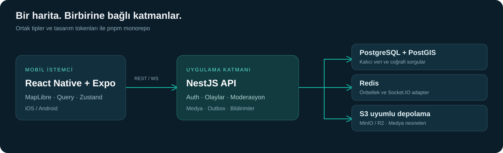

<p align="center"></p>
<p align="center"><strong>Şehrinde neler olduğunu keşfet. Bildir, teyit et, birlikte haberdar ol.</strong></p>
<p align="center">
<a href="LICENSE"></a>


</p>
<p align="center"><a href="#özellikler">Özellikler</a> · <a href="#mimari">Mimari</a> · <a href="#kurulum">Kurulum</a> · <a href="#dokümantasyon">Dokümantasyon</a> · <a href="CONTRIBUTING.md">Katkı</a></p>

ŞehirNabız, Türkiye'deki kaza, yol çalışması, altyapı arızası, afet, ulaşım aksaklığı ve yerel etkinlikleri konum üzerinden takip etmek için geliştirilen topluluk odaklı bir mobil platformdur. Olay bildirimi, topluluk teyidi ve moderasyonu tek bir harita deneyiminde birleştirir.

> **Geliştirme durumu:** MVP kod tabanı ve Phase 18A doğrulama raporu mevcuttur. Phase 18B cihaz ve dağıtım hazırlıkları sürmektedir. Bu depo, mağazada yayımlanmış bir uygulama veya canlı bir kamu bilgilendirme hizmeti duyurusu değildir. Demo olaylar sentetiktir.

## Özellikler

| Alan | Kapsam |
| --- | --- |
| Harita deneyimi | MapLibre Native vektör harita, kategori filtreleri ve konum seçimi |
| Olay bildirimi | Konum, kategori, açıklama ve medya ile bildirim akışı |
| Topluluk teyidi | Geri bildirim, güvenilirlik puanı ve moderasyon mekanizması |
| Gerçek zamanlı iletişim | Socket.IO güncellemeleri, bildirim tercihleri ve push altyapısı |
| Şehir istatistikleri | Coğrafi sorgular, şehir bazlı özetler ve yoğunluk verileri |
| Hesap yaşam döngüsü | JWT oturumları, refresh token rotasyonu ve hesap silme akışları |
| Güvenilir teslimat | Transactional outbox, yeniden deneme ve dağıtık çalışma hazırlıkları |

## Mimari



| Katman | Teknolojiler |
| --- | --- |
| Mobil | React Native 0.88, React 19, Expo SDK 58, Expo Router |
| Harita | `@maplibre/maplibre-react-native` |
| İstemci durumu | Zustand, TanStack Query |
| API | NestJS 12, TypeScript, TypeORM, Zod |
| Veri ve iletişim | PostgreSQL 16, PostGIS 3.4, Redis 7, Socket.IO |
| Medya | S3 uyumlu depolama, MinIO / Cloudflare R2, presigned URL |
| Araçlar | pnpm workspaces, Turborepo, Docker Compose, Vitest, Node test runner |

```text
apps/
  mobile/                 React Native + Expo uygulaması
  api/                    NestJS REST ve WebSocket API
packages/
  shared/                 Ortak tipler, DTO'lar ve Zod şemaları
  design-tokens/          Renk, tipografi ve aralık tokenları
  config/                 Ortak geliştirme yapılandırmaları
docs/                     Mimari, kurulum ve faz doğrulama raporları
docker/                   Staging altyapı yapılandırmaları
scripts/                  Yük testi, yedekleme ve migration araçları
graphify-out/             Proje bilgi grafı
```

Kod ve değişken adları İngilizce; arayüz ve uygulama hata mesajları Türkçedir.

## Kurulum

### Gereksinimler

- Node.js 24 önerilir; paket manifestindeki alt sınır Node.js 20'dir.
- `packageManager` alanında sabitlenen pnpm **12.6.0**.
- Yerel veri servisleri için Docker ve Docker Compose.
- Android için Android SDK ve uygun JDK; yerel iOS derlemesi için macOS ve Xcode.

### 1. Kaynak kod ve ortam

```bash
git clone https://github.com/ErdemYy/sehir-nabiz.git
cd sehir-nabiz
pnpm install --frozen-lockfile
cp apps/api/.env.example apps/api/.env
cp apps/mobile/.env.example apps/mobile/.env
```

PowerShell'de `cp` yerine `Copy-Item` kullanılabilir. API örneğindeki değerler yerel Docker varsayılanlarıyla uyumludur. JWT anahtarlarını kendiniz üretip `JWT_ACCESS_SECRET` ve `JWT_REFRESH_SECRET` alanlarına ayrı değerler yazın:

```bash
node -e "console.log(require('crypto').randomBytes(48).toString('base64'))"
```

Mobil `EXPO_PUBLIC_API_URL` değerini cihazınıza göre düzenleyin: Android emülatöründe `http://10.0.2.2:3001/api/v1`, fiziksel cihazda geliştirici bilgisayarının erişilebilir yerel IP adresini kullanın. `EXPO_PUBLIC_*` değerleri uygulama paketine girer; bu alanlara gizli anahtar koymayın.

### 2. Veri servisleri ve derleme

```bash
docker compose up -d
docker compose ps
pnpm --filter @sehir-nabiz/shared build
pnpm --filter @sehir-nabiz/design-tokens build
pnpm --filter sehir-nabiz-api build
```

Migration CLI ortam değişkenlerini süreçten okur. Node.js 24 ile örnek ortam dosyasını açıkça yükleyin:

```bash
cd apps/api
node --env-file=.env node_modules/typeorm/cli.js migration:run -d dist/database/data-source.js
cd ../..
```

Yerel servisler: PostgreSQL `5434`, Redis `6380`, MinIO S3 `9000`, MinIO konsolu `9001`. Bucket ve medya yapılandırması için [geliştirici rehberini](docs/DEVELOPMENT.md) inceleyin. Demo seed yalnızca geliştirme/test ortamları içindir.

### 3. API ve mobil uygulama

```bash
# Terminal 1
pnpm --filter sehir-nabiz-api start:dev

# Terminal 2: Android development build
pnpm --filter sehir-nabiz-mobile android
```

API sağlık kontrolü: `http://localhost:3001/api/v1/health`.

MapLibre Native için **development build** gerekir. Expo Go seçeneği sınırlı bir arayüz/harita simülasyonudur; native harita ve cihaz dağıtım doğrulamasının yerine geçmez. Ayrıntılar: [Expo Go önizleme rehberi](docs/EXPO_GO_IPHONE_PREVIEW.md) ve [MapLibre entegrasyonu](docs/guides/MAPLIBRE_INTEGRATION_GUIDE.md).

## Kalite kontrolleri

```bash
pnpm run typecheck
pnpm run test
pnpm run build
```

API entegrasyon ve E2E senaryoları PostgreSQL/PostGIS, Redis veya depolama servisleri gerektirebilir. Test koşulları [geliştirici rehberinde](docs/DEVELOPMENT.md) açıklanır. Bazı `lint` betikleri şu anda yalnızca yer tutucu mesaj üretir; gerçek bir lint doğrulaması olarak değerlendirilmemelidir.

## Gizlilik ve güvenlik

Konum bulanıklaştırma, medya metadata temizliği, hız sınırlama, oturum güvenliği ve hesap silme tasarımı [güvenlik ve gizlilik belgesinde](docs/architecture/SECURITY_PRIVACY.md) açıklanır. Üretim dağıtımından önce ortamınıza özel anahtarlar, TLS, depolama izinleri ve cihaz testleri tamamlanmalıdır. Örnek geliştirme parolaları üretimde kullanılmamalıdır.

Güvenlik açığı bildirim yöntemi: [SECURITY.md](SECURITY.md).

## Dokümantasyon

- [Geliştirici rehberi](docs/DEVELOPMENT.md)
- [Sistem mimarisi](docs/architecture/ARCHITECTURE.md)
- [Veri modelleri ve PostGIS](docs/architecture/DATA_MODELS.md)
- [Gerçek zamanlı sistem](docs/architecture/REALTIME_ARCHITECTURE.md)
- [Güvenlik, gizlilik ve moderasyon](docs/architecture/SECURITY_PRIVACY.md)
- [Geliştirme yol haritası](docs/architecture/ROADMAP_PHASES.md)
- [Phase 18A doğrulama raporu](docs/PHASE_18A_REPORT.md)
- [Phase 18B ilerleme raporu](docs/PHASE_18B_REPORT.md)
- [Ajanlar ve geliştiriciler için kurallar](AGENTS.md)

## Katkı ve lisans

Hata ve geliştirme önerileri için [Issues](https://github.com/ErdemYy/sehir-nabiz/issues), kod katkıları için [katkı rehberi](CONTRIBUTING.md) kullanılabilir.

ŞehirNabız kaynak kodu [MIT lisansı](LICENSE) ile sunulur. Üçüncü taraf kütüphaneler, fontlar, harita verileri ve tile servisleri kendi lisanslarına ve kullanım koşullarına tabidir; ilgili atıfları koruyun. Tanıtım çizimleri şematiktir ve uygulama ekran görüntüsü değildir.
