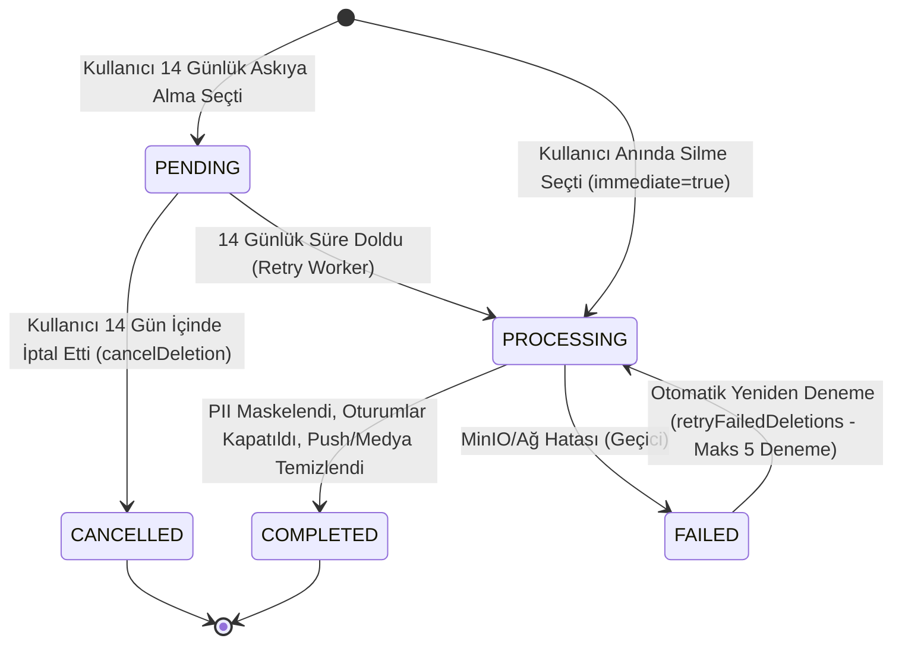

# ŞehirNabız — Güvenli Hesap Silme ve Veri Yaşam Döngüsü Mimarisi (ACCOUNT_DELETION_ARCHITECTURE.md)

**Faz:** Phase 14 — Güvenli Hesap Silme, Veri Yaşam Döngüsü ve Release Blocker Düzeltmeleri  
**Yasal ve Mağaza Standartları:** 6698 Sayılı KVKK, Apple App Store İnceleme Yönergesi 5.1.1(v), Google Play Veri Güvenliği Politikası  
**Durum:** Tamamlandı & Doğrulandı  

---

## 1. Mimari Vizyon ve Hedefler

Apple App Store ve Google Play yönergeleri uyarınca, hesap oluşturmaya izin veren her mobil uygulamanın:
1. Uygulama içerisinden doğrudan ve kolay erişilebilir biçimde **hesap ve kişisel verileri silme imkânı** sunması,
2. Uygulama kurulu olmasa dahi kullanıcıların web tarayıcısı üzerinden talepte bulunabileceği **kamuya açık bir web silme URL'i** sağlaması zorunludur.

ŞehirNabız, topluluk odaklı bir kentsel bilgi ekosistemi olduğundan, hesap silme mimarisi iki temel ilkeyi aynı anda sağlamak üzere tasarlanmıştır:
- **Tam Kişisel Gizlilik (PII Eradication):** Kullanıcının kimlik bilgileri, parolası, e-postası, oturumları, push bildirim anahtarları ve kişisel tercihleri sistemden kalıcı olarak imha edilir.
- **Kentsel Bilgi ve Kamu Güvenliği Bütünlüğü:** Vatandaşın geçmişte bildirdiği doğrulanmış kentsel olaylar (yol çökmesi, su arızası, trafik kazası vb.) şehir güvenliği ve geçmiş istatistik hafızası için silinmez; bildiren kişi bilgisi tamamen anonimleştirilir (`"Anonim Vatandaş"`).

---

## 2. Hesap Silme Talebi Yaşam Döngüsü (State Machine)

Hesap silme talepleri PostgreSQL `account_deletion_requests` tablosunda denetlenebilir ve atomik bir durum makinesiyle yönetilir:



### Durum Tanımları:
| Durum | Açıklama | Kullanıcı Durumu (`accountStatus`) |
| :--- | :--- | :--- |
| **`PENDING`** | 14 günlük yasal cayma / bekleme süresindeki talep. | `PENDING_DELETION` |
| **`PROCESSING`** | Silme ve anonimleştirme işlemi yürütülüyor. | `PENDING_DELETION` |
| **`COMPLETED`** | Kişisel veriler silindi, e-posta maskelendi, olaylar anonimleştirildi. | `DELETED` |
| **`CANCELLED`** | Kullanıcı bekleme süresinde şifresini girerek işlemi iptal etti. | `ACTIVE` |
| **`FAILED`** | MinIO veya nesne deposu hatası nedeniyle yeniden deneme kuyruğuna alındı. | `DELETED` (PII maskeli) |

---

## 3. Veri Silme ve Anonimleştirme Politikası

| Veri Kategorisi | Veri Tabanı / Konum | Silme / Anonimleştirme Eylemi | Gerekçe |
| :--- | :--- | :--- | :--- |
| **E-posta Adresi** | `users.email` | `deleted_<timestamp>_<uuid>@deleted.sehirnabiz.local` olarak maskelenir. | Unique kısıtı korunur; kullanıcının gerçek e-postası kalıcı olarak yok edilir. |
| **Görünen Ad** | `users.displayName` | `"Anonim Vatandaş"` olarak güncellenir. | Profildeki tüm kişisel izler kaldırılır. |
| **Parola Hash'i** | `users.passwordHash` | `"*DELETED*"` dizesiyle ezilir. | Eski şifreyle veya hash analiziyle oturum açılamaz. |
| **İtibar Puanı** | `users.reputationScore` | `0` olarak sıfırlanır. | Kullanıcı hakları ve seviyeleri sonlandırılır. |
| **Oturumlar (JWT Refresh)** | `refresh_tokens` | Tüm aktif tokenlar `isRevoked: true` yapılır. | Tüm mobil ve web oturumları derhal geçersiz kılınır. |
| **Aktif WebSocket** | `RealtimeGateway` | Kullanıcı ID'sine ait tüm socket'ler anında disconnect edilir. | Canlı veri ve bildirim dinlemesi derhal kesilir. |
| **Cihaz Push Belirteçleri** | `device_push_tokens` | Kullanıcıya ait tüm kayıtlar `DELETE` edilir. | Apple APNs ve Google FCM üzerinden yeni push gitmesi imkansız kılınır. |
| **Kullanıcı Bildirimleri** | `user_notifications` | Kullanıcıya ait tüm satırlar `DELETE` edilir. | Kişisel bildirim geçmişi temizlenir. |
| **Bildirim Tercihleri** | `user_notification_preferences` | Kullanıcıya ait ayar satırı `DELETE` edilir. | Kişisel ayarlar silinir. |
| **Kentsel Olay Bildirimleri** | `events` | **Silinmez**, yazar kimliği `"Anonim Vatandaş"` olarak korunur. | Şehir güvenliği ve kentsel afet/kaza geçmişi veri kaybına uğramaz. |
| **Olay Fotoğrafları (Medya)** | MinIO / S3 `event_media` | Onaylanmamış (`PENDING_UPLOAD`, `REJECTED`) fotoğraflar MinIO'dan silinir. | Yayında olmayan ham veya taslak görseller temizlenir. |

---

## 4. API Uç Noktaları Spesifikasyonu

### 4.1 Uygulama İçi Hesap Silme (DELETE /api/v1/users/me)
- **Yetki:** `Bearer <JWT_ACCESS_TOKEN>` (Zorunlu)
- **Gövde (Body):**
  ```json
  {
    "password": "MevcutHesapSifresi123!",
    "reason": "Artık kullanmıyorum",
    "immediate": true
  }
  ```
- **Güvenlik Doğrulamaları:**
  1. Başkasının hesabını silme engeli: Yalnızca JWT token içerisindeki `sub` (kullanıcı ID) için işlem yapılır.
  2. Şifre doğrulama: `bcrypt.compare` ile mevcut parola doğrulanır; hatalıysa `401 Unauthorized` döner.
  3. Concurrency guard: Aynı anda gelen mükerrer veya yarış halindeki silme istekleri `409 Conflict` ile engellenir.
  4. Token invalidation: `JwtStrategy`, `accountStatus === DELETED` olan kullanıcının eski access token'ını derhal `401 Unauthorized` ile reddeder.

### 4.2 Silme Talebini İptal Etme (POST /api/v1/users/me/cancel-deletion & POST /api/v1/users/cancel-deletion)
- Kullanıcı 14 günlük bekleme modundayken şifresini girerek silme talebini iptal edebilir.
- Oturumu kapanmış kullanıcılar için e-posta ve şifre ile doğrudan iptal uç noktası mevcuttur.

### 4.3 Silme Durumu Sorgulama (GET /api/v1/users/me/deletion-status)
- Kullanıcının aktif bir silme talebi olup olmadığını (`hasPendingDeletion`), planlanan tarihi (`scheduledFor`) ve iptal edebilirlik durumunu (`canCancel`) döner.

### 4.4 Web Üzerinden Hesap Silme Talebi (POST /api/v1/users/web-deletion-request)
- **Yetki:** Açık Uç Nokta (Rate Limit Korumalı)
- **Gövde (Body):**
  ```json
  {
    "email": "vatandas@example.com",
    "password": "MevcutHesapSifresi123!",
    "reason": "Web talep formu üzerinden silme",
    "immediate": true
  }
  ```
- E-posta ve şifre doğrulanır, işlem `clientSource = 'WEB_REQUEST'` olarak denetim kütüğüne kaydedilir.

### 4.5 Web Hesap Silme Arayüzü (GET /account-deletion)
- Kamu erişimine açık, bağımsız, responsive ve Urban Floating UI temalı HTML sayfası.
- Marka adı, KVKK aydınlatması, şifreli kimlik doğrulama formu ve anlık durum bildirim kutusu içerir.

---

## 5. Nesne Deposu (MinIO) Hata Toleransı & Yeniden Denenebilirlik (Retry Engine)

Silme işlemi sırasında MinIO veya S3 nesne deposunda geçici bir ağ kesintisi yaşanırsa:
1. Veritabanı transaction'ı çökertilmez; kişisel kimlik verileri güvenle anonimleştirilir.
2. Silme talebi `status = 'FAILED'` ve `lastError = 'MinIO silme hatası: ...'` olarak işaretlenir.
3. `AccountDeletionService.retryFailedDeletions()` metodu, başarısız olan veya 14 günlük süresi dolan talepleri periyodik olarak tarar ve azami 5 denemeye kadar nesne silme işlemini yeniden dener.

---

## 6. Mobil Kullanıcı Deneyimi (Urban Floating UI)

Mobil arayüzde Ayarlar ekranında (`apps/mobile/app/profile/settings.tsx`):
- Yalnızca oturum açmış kullanıcılara özel **"Hesap Yönetimi & Veri Silme"** kartı gösterilir.
- Yumuşak kırmızı tehlike tonları (`#EF4444`), minimum 48px dokunma hedefi ve Pill radius butonlar kullanılır.
- Kullanıcı butona bastığında açılan modal:
  1. Hangi verilerin silineceğini ve hangi kentsel olayların kamu yararı adına anonimleştirileceğini açıkça açıklar.
  2. Yanlışlıkla basılmayı önlemek amacıyla kullanıcıdan hesap parolasını girmesini ister.
  3. Hemen silme veya 14 günlük askıya alma seçeneği sunar.
  4. Başarılı işlem sonrası cihazdaki yerel taslakları (`draftService.clearDraft()`) siler, çıkış yapar (`logout()`) ve kullanıcıyı ana sayfaya yönlendirir.
