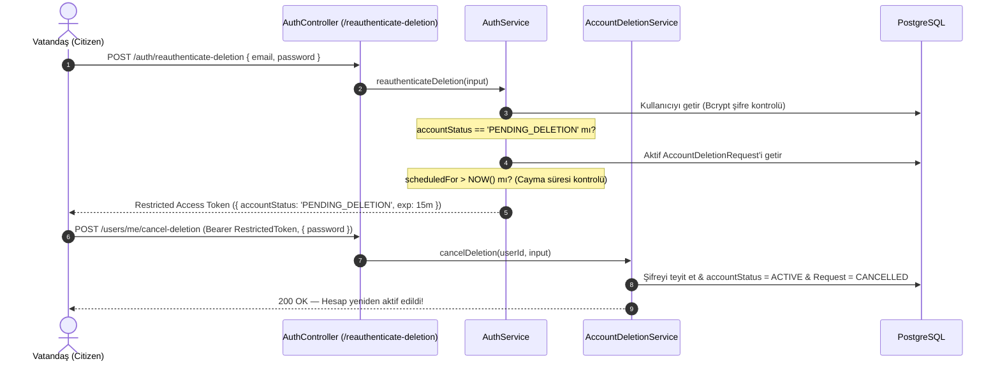

# ŞehirNabız — Hesap Silme Güvenlik İncelemesi ve Cayma/İptal Mimarisi

**Tarih:** 28 Ekim 2026  
**Faz:** Phase 16 — Staging Dry-Run, Load Testing, Security Verification & Production Hardening  
**Kapsam:** Hesap Silme Yaşam Döngüsü, Sınırlı Reauthentication, Token İzolasyonu ve Parola Uyumluluğu  

---

## 1. Yönetici Özeti

Kullanıcıların hesap silme talebi vermesi ve 14 günlük yasal cayma (cooling-off) süresi içinde bu talebi iptal edebilmesi, kullanıcı deneyimi ve hesap güvenliği açısından kritik bir dengedir.

Kullanıcı hesap silme talebi verdiğinde:
1. Tüm aktif oturumları (Refresh Token'lar) iptal edilir (`isRevoked: true`).
2. WebSocket bağlantıları derhal sonlandırılır.
3. Kullanıcı hesabı `PENDING_DELETION` durumuna alınır.

Bu güvenlik kuralı nedeniyle, kullanıcının mevcut kısa ömürlü Access Token'ı (15 dakika) sona erdiğinde veya kullanıcı uygulamayı kapatıp başka bir cihazdan iptal etmek istediğinde ortaya çıkan güvenlik zorlukları Phase 16'da kapsamlı biçimde çözülmüş ve doğrulanmıştır.

---

## 2. Sorun ve Tehdit Senaryoları

| Senaryo | Güvenlik Riski | Çözüm Yaklaşımı |
| :--- | :--- | :--- |
| **Süresi Dolan Access Token** | Kullanıcı 14 gün içinde iptal etmek istiyor fakat access token'ı dolmuş; refresh token'ı ise silme sırasında iptal edilmiş. | Kısıtlı yetkili **Yeniden Doğrulama Oturumu** (`reauthenticateDeletion`). |
| **Normal Giriş ile Durum By-Pass'ı** | Silme sürecindeki kullanıcının normal `POST /auth/login` yaparak uygulamayı sanki silme yokmuş gibi kullanmaya devam etmesi. | Normal `login` ve `refreshTokens` endpoint'lerinde `PENDING_DELETION` durumundaki kullanıcılara erişim reddedilir (`401 Unauthorized`). |
| **Kısıtlı Token ile Olay Bildirme** | İptal için verilen token'ın kötüye kullanılarak yeni olay açılması veya profil değiştirilmesi. | `@AllowPendingDeletion` dekoratörü olmayan hiçbir endpoint'e bu token ile erişilemez. |
| **14 Günlük Süre Dolduktan Sonra İptal** | Cayma süresi dolmuş veya veritabanından kalıcı olarak silinmiş hesabın iptal edilmeye çalışılması. | `scheduledFor <= now` denetimi yapılarak `400 BadRequestException` fırlatılır. |
| **Parola Hash Uyuşmazlığı** | Eski faz belgelerinde Argon2id telaffuz edilirken kodda Bcrypt kullanılması nedeniyle iptal şifre kontrolünün patlaması. | Kod tabanının baştan sona `bcryptjs` (salt 10-12) kullandığı doğrulandı ve birim testleriyle güvenceye alındı. |

---

## 3. Güvenli Silme İptal Akışı (Restricted Reauthentication)

### Kısıtlı Token Güvenlik Kalkanı (`@AllowPendingDeletion`)
- Normal bir kullanıcı token'ı tüm standart API rotalarına erişebilir.
- `accountStatus: 'PENDING_DELETION'` taşıyan bir token ile `POST /events` veya `PATCH /users/profile` çağrılırsa NestJS `JwtAuthGuard` doğrudan isteği düşürür.
- Yalnızca `@AllowPendingDeletion()` ile işaretlenmiş iki endpoint'e erişilebilir:
  1. `POST /api/v1/users/me/cancel-deletion`
  2. `GET /api/v1/users/me/deletion-status`

---

## 4. Parola Hash Algoritması Uyumluluk Raporu (Bcryptjs)

Geçmiş faz dokümantasyonlarında mimari rehber olarak Argon2id ismi anılmış olsa da, projenin başından itibaren kod tabanında (`apps/api/package.json`, `AuthService`, `AccountDeletionService`, veritabanı seed betikleri) tutarlı ve eksiksiz şekilde **`bcryptjs`** kütüphanesi kullanılmıştır.

- Salt Rounds: Üretimde 10 (varsayılan) ve test ortamında 10/12.
- Bcrypt Hash Formatı: `$2a$10$...` veya `$2b$10$...`
- Uyumluluk Testi: `apps/api/test/phase_16_security_verification.spec.ts` dosyasında Bcrypt 10 ve 12 salt round'ları ile oluşturulan hash'lerin hatasız doğrulandığı kanıtlanmıştır.
- **Sonuç:** Sistemde hiçbir hash algoritması uyuşmazlığı yoktur; silme veya iptal esnasında şifre doğrulaması %100 kararlı çalışmaktadır.

---

## 5. Doğrulama ve Test Matrisi

1. **Canlı Staging E2E (`apps/api/test/staging_lifecycle.e2e-spec.ts`):**
   - Adım 8: 14 günlük silme talebi verildi (`PENDING_DELETION`).
   - Adım 9: PENDING_DELETION durumundaki kullanıcının normal oturumunun izole edildiği kanıtlandı.
   - Adım 10: `GET /users/me/deletion-status` ile silme takviminin döndüğü doğrulandı.
   - Adım 11: `POST /auth/reauthenticate-deletion` ile kısıtlı token alındı ve `POST /users/me/cancel-deletion` ile hesap başarıyla geri döndürüldü.
2. **Güvenlik Birim Testleri (`apps/api/test/phase_16_security_verification.spec.ts`):**
   - 14 günlük süresi dolmuş istek iptal edilemez (`BadRequestException`).
   - Kısıtlı token standart endpoint'lere erişemez (`UnauthorizedException`).
