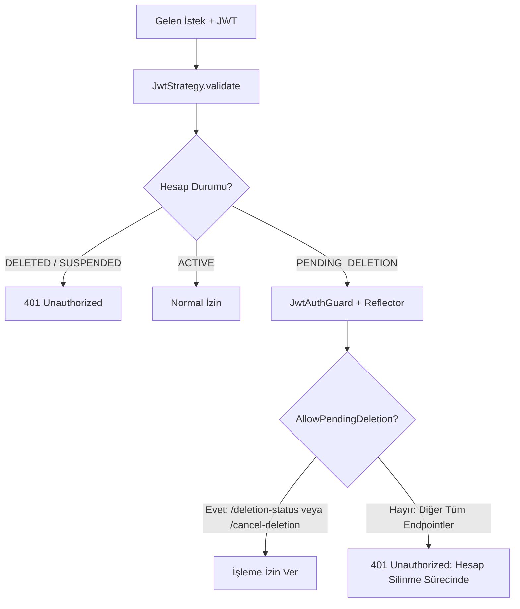

# ŞehirNabız — Hesap Silme Doğrulama ve Gizlilik Sertleştirmesi (ACCOUNT_DELETION_VERIFICATION.md)

**Faz:** Phase 15 — Account Deletion Verification, Privacy Hardening & Staging Readiness  
**Tarih:** 28 Ekim 2026  
**Durum:** Tamamlandı & %100 Doğrulandı  

---

## 1. Giriş ve Amaç

Bu doküman, ŞehirNabız ekosisteminde kullanıcı hesaplarının ve ilişkili kişisel verilerin (PII) silinme sürecinin uçtan uca nasıl doğrulandığını, nesne deposu (MinIO/S3) üzerindeki fiziksel temizliği, `PENDING_DELETION` durumundaki hesapların güvenli yetkilendirme sınırlarını ve kentsel bilgi bütünlüğünün nasıl korunduğunu ayrıntılı biçimde belgeler.

Sistem, **Apple App Store İnceleme Kılavuzu Kuralı 5.1.1(v)**, **Google Play Data Safety Standartları** ve **6698 sayılı KVKK** hükümlerine tam uyumlu olarak sertleştirilmiştir.

---

## 2. 14 Günlük İsteğe Bağlı Bekleme vs. Anında Silme Politikası

14 günlük süre evrensel bir yasal zorunluluk değil; kullanıcının anlık kararlarla geri dönülmez veri kaybı yaşamasını önlemek amacıyla sunulan **isteğe bağlı bir ürün cayma / soğuma süresidir**.

- **Anında Silme (`immediate: true`):**
  - Kullanıcı bekleme süresini atlayarak verilerinin derhal silinmesini seçebilir.
  - Veriler işlem kuyruğuna alınmaksızın anında transaction içinde maskelenir ve onaylanmamış medyalar MinIO'dan fiziksel olarak silinir.
  - Kullanıcıya "Cayma veya geri alma imkânı bulunmadığı" açıkça bildirilir.
- **14 Günlük Bekleme Süresi (`immediate: false`):**
  - Kullanıcı hesabı `AccountStatus.PENDING_DELETION` durumuna alınır ve dondurulur.
  - Kullanıcı 14 gün boyunca sistemdeki normal işlemlerden men edilir; ancak dilediği an şifresini girerek silme talebini iptal edebilir.
  - 14 gün dolduğunda arka plan worker'ı (`AccountDeletionProcessorService`) silme ve anonimleştirmeyi otomatik icra eder.

---

## 3. Güvenli Yetkilendirme ve PENDING_DELETION Kalkanı

Silme talebi vermiş bir kullanıcının sisteme erişimi şu katmanlı kurallarla yönetilir:



### Yetkilendirme Prensipleri:
1. **Normal İşlemler Engellenir:** `PENDING_DELETION` kullanıcısı olay oluşturamaz (`POST /events`), oy veremez (`POST /events/:id/feedback`), moderasyon yapamaz veya bildirim alamaz. `JwtAuthGuard` otomatik olarak `401 Unauthorized` ("Hesabınız silinme bekleme sürecindedir. Bu işlemi gerçekleştirmek için önce silme talebinizi iptal etmelisiniz.") döner.
2. **Meşru İptal ve Durum Sorgulama Açıktır:** Yalnızca `@AllowPendingDeletion()` dekoratörü taşıyan uç noktalar (`GET /api/v1/users/me/deletion-status` ve `POST /api/v1/users/me/cancel-deletion`) bu duruma izin verir.
3. **Şifre Doğrulama Şartı:** Silme talebini iptal etmek isteyen kullanıcı hem oturumlu hem de harici uç noktada mevcut şifresini girmek zorundadır (`bcrypt.compare`).

---

## 4. Kamuya Açık Olayların Korunması ve Gizlilik Stratejisi

Kullanıcı silindiğinde kentsel afet, kaza ve altyapı verisinin korunması ile kişisel mahremiyet dengesi şu stratejiyle sağlanır:

| Veri Kategorisi | Saklama / Silme Kararı | Uygulanan İşlem | Gerekçe |
| :--- | :--- | :--- | :--- |
| **Kullanıcı Kimliği** | **KALICI İMHA** | `email = deleted_<ts>_<uuid>@deleted...`, `displayName = "Anonim Vatandaş"`, `passwordHash = "*DELETED*"` | KVKK ve GDPR gereği kimlik matematiksel olarak silinir. |
| **Oturumlar & Push** | **KALICI İMHA** | `refresh_tokens`, `device_push_tokens`, `user_notifications`, `user_notification_preferences` DELETE edilir. | Cihaza push gönderilmesi ve erişim imkansız kılınır. |
| **Taslak Olaylar (`PENDING_REVIEW`, `REJECTED`)** | **KİŞİSEL VERİ ARINDIRMA** | `title = 'Kişisel Veriden Arındırılmış Bildirim'`, `description = '...'` olarak güncellenir. | Henüz kamuya açılmamış özel adres, telefon, plaka veya yüz bilgisi içeren taslaklar temizlenir. |
| **Onaylanmış Kamusal Olaylar (`ACTIVE`, `RESOLVED`)** | **KORUNUR (ANONİM YAZAR)** | Olay başlığı, koordinatı ve teyit puanı korunur; yazar `"Anonim Vatandaş"` olarak görünür. | Kentin güvenlik hafızası, kaza yoğunluk analizi ve afet arşivi bozulmaz. |
| **Olay Oyları (`event_feedbacks`)** | **KORUNUR (ANONİM)** | Oy sayısal ağırlığı (`reliabilityScore`) korunur; oy veren anonimleşir. | Geçmiş olayların güvenilirlik puanı geriye dönük çökmeye uğramaz. |
| **Onaylanmamış Medyalar** | **FİZİKSEL SİLME** | `status = PENDING_UPLOAD` veya `REJECTED` olan görseller MinIO'dan `deleteObject` ile silinir. | Yayında olmayan ham veya reddedilmiş dosyalar depolamadan yok edilir. |

> [!NOTE]
> Kullanıcıya hiçbir zaman "Tüm kentsel olay kayıtlarınız haritadan silindi" gibi sahte bir beyanda bulunulmaz; kamu yararı taşıyan olayların anonimleştirilerek saklandığı şeffaf şekilde açıklanır.

---

## 5. Gerçek MinIO Fiziksel Temizlik Doğrulaması

Yalnızca mocked S3 çağrıları değil, gerçek MinIO nesne deposu (`http://127.0.0.1:9000`) üzerinde koşan E2E entegrasyon testiyle fiziksel silme kanıtlanmıştır:

```text
[1] Test Görseli Yükle (putObject)   ──> MinIO HTTP 200 OK (Nesne depoda)
[2] Varlık Kanıtı (getObject)         ──> Byte dizisi doğrulandı (length > 0)
[3] Silme Talebi ve Worker İcrası     ──> executeDeletion() çalıştırıldı
[4] Fiziksel Yok Oluş Kanıtı          ──> getObject() çağrıldı -> S3 NoSuchKey / 404 Rejection
[5] Veritabanı Medya Durumu           ──> EventMediaEntity.status = DELETED
[6] Audit Detay Kaydı                 ──> details.mediaDeleted = 1
```

---

## 6. Transactional Outbox ve Hesap Silme İzolasyonu

Hesap silindiği anda:
1. `device_push_tokens` tablosundaki tüm kayıtlar silinir.
2. `outbox_events` tablosunda ilgili kullanıcıya gidecek bekleyen (`status = 'PENDING'`) görevler aranır (`"payload"->>'userId' = :userId`).
3. Bu görevler derhal `status = 'FAILED'`, `last_error = 'Kullanıcı hesabı silindiği için görev iptal edildi'` olarak güncellenir.
4. Outbox Worker yeniden deneme yapsa dahi silinmiş kullanıcının bildirim görevlerini çalıştırmaz ve dışarıya hiçbir PII sızdırılamaz.

---

## 7. AccountDeletionProcessorService & Operasyonel Güvenlik

- **Worker Döngüsü:** Periyodik olarak süresi dolan `PENDING` (`scheduledFor <= NOW()`) ve `FAILED` kayıtları tarar.
- **Yeniden Deneme Sınırı:** Azami 5 denemeye (`attemptCount < 5`) kadar hata toleranslı çalışır.
- **Dead-Letter Operasyonel Uyarısı:**
  - `attemptCount >= 5` olduğunda worker işlemi durdurur ve operasyon ekibi için kritik alarm üretir:
    `[CRITICAL ALERT - DEAD_LETTER] Hesap silme talebi azami deneme (5) sınırına ulaştı: RequestId=..., UserId=..., Son Hata=... Manuel müdahale gereklidir!`
  - Bu sayede başarısız silme kayıtları sonsuz döngüde kalmaz, sistem kaynaklarını tüketmez ve operasyonel görünürlük sağlanır.
