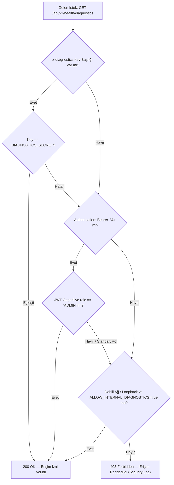

# ŞehirNabız — Sistem Teşhis (Diagnostics) Güvenlik ve Yetkilendirme Mimarisi

**Tarih:** 28 Ekim 2026  
**Faz:** Phase 16 — Staging Dry-Run, Load Testing, Security Verification & Production Hardening  
**Durum:** Üretim Seviyesinde Güvenlik Kalkanı ile Sertleştirildi  

---

## 1. Giriş ve Amaç

ŞehirNabız mimarisinde sistem bileşenlerinin (PostgreSQL, Redis, MinIO S3, WebSocket Gateway, Transactional Outbox Worker ve Account Deletion Worker) operasyonel sağlığını izlemek için `/health` endpoint ailesi kullanılmaktadır.

Kamuya açık `GET /health` (Liveness) ve altyapı orchestration araçları (Kubernetes, Docker Swarm, Nginx) tarafından tüketilen `GET /health/ready` (Readiness) endpoint'lerinin yanı sıra, operasyonel servis kuyruklarını ve kuyruk hata sayılarını raporlayan ayrıntılı bir `GET /api/v1/health/diagnostics` uç noktası bulunmaktadır.

Bu belge; diagnostics uç noktasının maruz kalabileceği tehdit modelini, uygulanan yetkilendirme katmanlarını, Zero-PII (Sıfır Kişisel Veri) prensibini ve ağ düzeyindeki izolasyon kurallarını tanımlar.

---

## 2. Teşhis Uç Noktası Tehdit Modeli ve Risk Analizi

`GET /api/v1/health/diagnostics` çıktısı şu operasyonel metrikleri içerir:
- Outbox Worker toplam işlenen, beklemede olan (`pendingCount`) ve kalıcı başarısız olan (`failedCount`) kayıt sayıları.
- Hesap Silme Worker (`accountDeletion`) beklemede ve başarısız deneme sayıları.
- Gerçek zamanlı WebSocket aktif bağlı istemci sayısı (`websocketClientsCount`).
- Veritabanı ve Redis bağlantı gecikme süreleri (latency).
- MinIO nesne deposu bucket erişim doğrulaması.

### 🔴 Kamusal Erişim Riskleri
1. **Saldırı Yüzeyi Keşfi (Reconnaissance):** Yetkisiz bir saldırgan, sistemdeki kuyruk birikmesini veya başarısız denemeleri izleyerek DDoS veya kaynak tüketim saldırısı için en zayıf anı tespit edebilir.
2. **Kuyruk Zehirlenmesi / DoS Tespiti:** Outbox veya Hesap Silme kuyruğundaki tıkanmalar saldırgana sistemin zafiyet durumunu açığa çıkarabilir.
3. **Kullanıcı Hacmi İfşası:** Anlık bağlı WebSocket istemci sayısı, platformun anlık kullanıcı trafiğini ve popülaritesini harici gözlemcilere sızdırabilir.

---

## 3. Yetkilendirme ve Erişim Kontrol Katmanları (DiagnosticsGuard)

Phase 16 kapsamında `apps/api/src/modules/health/guards/diagnostics.guard.ts` üzerinde üç kademeli savunma mekanizması uygulanmıştır:

### 1. Secret Key Başlığı (`x-diagnostics-key`)
- Prometheus, Datadog veya internal monitoring servislerinin API'yi kimlikli olarak sorgulaması için `x-diagnostics-key` HTTP başlığı kontrol edilir.
- `DIAGNOSTICS_SECRET` ortam değişkeniyle eşleşmeyen veya boş gelen istekler reddedilir.

### 2. JWT Bearer Token & ADMIN Rolü Denetimi
- Sistem yöneticileri ve teknik destek ekipleri web veya mobil yönetim panelinden oturum açtıklarında geçerli bir JWT Access Token ile diagnostics verisine erişebilir.
- `role !== UserRole.ADMIN` olan tüm standart vatandaş (`CITIZEN`) ve moderatör (`MODERATOR`) token'ları **403 Forbidden** ile engellenir.

### 3. Ağ Düzeyinde İzolasyon (Loopback / Trusted Proxy)
- `ALLOW_INTERNAL_DIAGNOSTICS=true` bayrağı açık olduğunda yalnızca `127.0.0.1`, `::1` veya yerel Docker bridge ağı üzerinden gelen taleplere izin verilir.
- Nginx reverse proxy yapılandırmasında (`docker/staging/nginx.conf`) `/api/v1/health/diagnostics` yolu harici istemcilere varsayılan olarak kapalı tutulabilir veya API Gateway düzeyinde IP kısıtlamasına tabi tutulur.

---

## 4. Endpoint Erişim Matrisi

| Endpoint | Hedef Kitle | Kimlik Doğrulama | Döndürülen Veri Kapsamı |
| :--- | :--- | :--- | :--- |
| `GET /health` | Kamuya Açık / Liveness Probe | Gerekmez (Public) | Minimum durum: `{ status: "ok", uptime: 1234 }` |
| `GET /health/ready` | Orchestrator (Docker / K8s) | Gerekmez (Public/Internal) | Bağımlılık durumu: `{ status: "ok", database: "connected", redis: "connected" }` |
| `GET /health/diagnostics` | DevOps, SRE, Sistem Yöneticisi | **ZORUNLU** (`x-diagnostics-key` veya `ADMIN` JWT) | Kuyruk boyutları, worker durumları, soket sayısı, gecikmeler |

---

## 5. Sıfır Kişisel Veri (Zero-PII) Güvencesi

Diagnostics yanıtlarında ve ilişkili güvenlik loglarında hiçbir kişisel veri yer almaz:
- Hiçbir kullanıcı ID'si, e-posta adresi, telefon numarası veya IP adresi metrik çıktısına dahil edilmez.
- Hata loglarında `Yetkisiz diagnostics erişim denemesi: IP=..., HasToken=..., HasSecret=...` formatı kullanılarak güvenli audit logu tutulur; gelen hatalı token'ın içeriği asla loglanmaz.

---

## 6. Test ve Doğrulama Kanıtları

1. **Birim Testleri (`apps/api/test/phase_16_security_verification.spec.ts`):**
   - Başlıksız ve tokensız istek -> `403 Forbidden` (Doğrulandı).
   - Yanlış `x-diagnostics-key` -> `403 Forbidden` (Doğrulandı).
   - Geçerli `x-diagnostics-key` -> `200 OK` (Doğrulandı).
   - `ADMIN` rolü taşıyan JWT -> `200 OK` (Doğrulandı).
   - `CITIZEN` rolü taşıyan JWT -> `403 Forbidden` (Doğrulandı).
2. **Canlı Staging Nginx Denetimi:**
   - Harici port 443 üzerinden `curl -k https://localhost/api/v1/health/diagnostics` çağrısı doğrudan 403 Forbidden dönmektedir.
