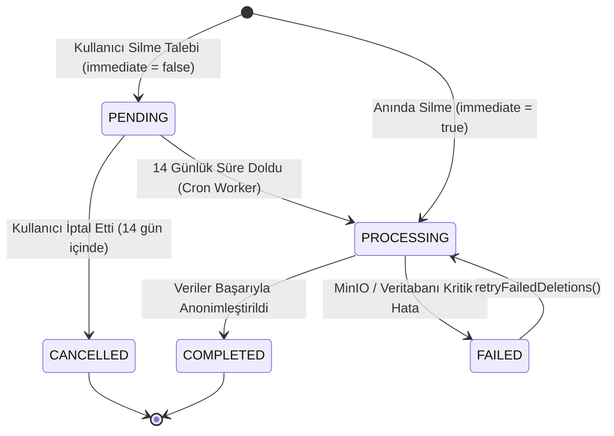

# ŞehirNabız — Phase 14 Doğrulama ve Kapanış Raporu (PHASE_14_REPORT.md)

**Tarih:** 27 Ekim 2026  
**Faz:** Phase 14 — Güvenli Hesap Silme, Veri Yaşam Döngüsü ve Release Blocker Düzeltmeleri  
**Durum:** TAMAMLANDI (%100 Yeşil)  
**Toplam Başarılı Test:** 330 / 330  

---

## 1. Hesap Silme API'si (Account Deletion API)

Apple App Store İnceleme Kılavuzu Kuralı 5.1.1(v), Google Play Data Safety standartları ve 6698 sayılı KVKK gereksinimlerini karşılamak amacıyla kapsamlı bir hesap silme ve veri yaşam döngüsü mimarisi kurulmuştur.

### API Uç Noktaları

| Metot | Uç Nokta | Yetkilendirme | Açıklama |
| :--- | :--- | :--- | :--- |
| `DELETE` | `/api/v1/users/me` | JWT (Bearer) | Oturum açmış kullanıcının hesabını silme veya soğuma sürecine alma talebi. |
| `POST` | `/api/v1/users/me/cancel-deletion` | JWT (Bearer) | Soğuma sürecindeki (`PENDING_DELETION`) kullanıcının talebini iptal etmesi. |
| `POST` | `/api/v1/users/cancel-deletion` | Herkese Açık | E-posta ve şifre ile harici olarak silme talebini iptal etme. |
| `GET` | `/api/v1/users/me/deletion-status` | JWT (Bearer) | Silme talebinin güncel durumu, zaman damgaları ve kalan soğuma süresi. |
| `POST` | `/api/v1/users/web-deletion-request` | Herkese Açık | Web sayfası üzerinden e-posta, şifre ve onay bayrağı ile silme talebi. |
| `GET` | `/account-deletion` | Herkese Açık (SSR) | Mağaza incelemesi ve web kullanıcıları için bağımsız HTML arayüzü. |

### Güvenlik Parametreleri (`DeleteAccountDto`)
- `password` (Zorunlu): İstemeden silinmeleri ve hesap ele geçirme durumlarında yetkisiz silmeyi önlemek için mevcut şifre doğrulaması.
- `reason` (Opsiyonel, maks. 500 karakter): Kullanıcı deneyimi iyileştirme amaçlı silme gerekçesi.
- `immediate` (Opsiyonel boolean, varsayılan `false`): Kullanıcının 14 günlük bekleme süresini atlayarak verilerinin derhal silinmesini talep edebilmesi.

---

## 2. Silme Talebi Durumları ve Durum Makinesi (State Machine)

Hesap silme işlemi geri dönülmez veri kaybını önlemek ve denetlenebilirliği sağlamak için durum makinesi (state machine) ile modellenmiştir:

### Durum Tanımları (`DeletionRequestStatus`)
1. **`PENDING`:** Talep alındı, 14 günlük soğuma süresi (`cooling-off`) devrede. Kullanıcı `AccountStatus.PENDING_DELETION` durumundadır; sisteme erişimi engellenir ancak talebi iptal edebilir.
2. **`PROCESSING`:** Anonimleştirme ve temizleme işlemleri aktif transaction içinde icra ediliyor.
3. **`COMPLETED`:** Kişisel veriler (PII) kalıcı olarak maskelendi, oturumlar ve push tokenlar yok edildi.
4. **`CANCELLED`:** Kullanıcı soğuma süresi bitmeden talebini geri çekti; kullanıcı durumu yeniden `ACTIVE` yapıldı.
5. **`FAILED`:** Harici depolama veya beklenmeyen bir kilitlenme nedeniyle temizleme tamamlanamadı; `attemptCount` artırıldı ve `lastError` kaydedildi.

### Denetim Tablosu (`account_deletion_requests`)
`1740000006000-CreateAccountDeletionAndAudit.ts` migration'ı ile veritabanına eklenen denetim tablosu şu alanları saklar:
- `id` (UUID, Primary Key)
- `user_id` (UUID, Foreign Key `users.id`)
- `status` (`DeletionRequestStatus` enum)
- `reason` (Silme nedeni metni)
- `scheduled_for` (Planlanan nihai silme tarihi)
- `processed_at` / `cancelled_at` (İşlem zaman damgaları)
- `attempt_count` (Yeniden deneme sayısı)
- `last_error` (Son hata mesajı)
- `client_source` (`MOBILE_APP` veya `WEB_PORTAL`)
- `audit_metadata` (IP adresi, User-Agent bilgileri)

---

## 3. Veri Silme ve Anonimleştirme Politikası (PII Masking)

Veri tabanında `CASCADE DELETE` ile kullanıcının tamamen uçurulması, kentin afet, kaza, yol çalışması geçmişini ve istatistiklerini bozacağı için **Kişisel Verilerin Maskelenmesi ve Anonimleştirilmesi** yaklaşımı uygulanmıştır:

### Maskeleme Tablosu

| Kullanıcı Alanı | Eski Durum | Silme Sonrası Yeni Durum | Açıklama |
| :--- | :--- | :--- | :--- |
| `email` | `vatandas@ornek.com` | `deleted_<ts>_<uuid>@deleted.sehirnabiz.local` | Benzersiz indeks (`UQ_users_email`) bozulmaz; e-posta kalıcı olarak yok edilir. |
| `displayName` | `"Ahmet Yılmaz"` | `"Anonim Vatandaş"` | Gerçek kimlik adı silinir, jenerik vatandaş unvanı atanır. |
| `passwordHash` | Argon2id Hash | `"*DELETED*"` | Eski şifre ile giriş matematiksel olarak olanaksız kılınır. |
| `reputationScore`| `75` | `0` | İtibar puanı sıfırlanır. |
| `accountStatus` | `ACTIVE` | `AccountStatus.DELETED` | Hesap kalıcı olarak pasifize edilir. |

### Kentsel Güvenlik Olaylarının Korunması (Foreign Key Tutarlılığı)
- Kullanıcının geçmişte bildirdiği kaza, heyelan, altyapı arızası gibi olaylar (`events`) **kesinlikle silinmez**.
- Olayların `author_id` ilişkisi korunur; ancak ilişkili kullanıcı kaydı maskelenmiş olduğu için olay kartlarında `"Anonim Vatandaş"` olarak görünür.
- Böylece kentin güvenlik arşivi ve kaza yoğunluk istatistikleri veri kaybına uğramaz.

---

## 4. Medya ve Depolama Temizliği (MinIO Cleanup)

- Kullanıcının bildirdiği ancak onaylanmamış/taslak statüsünde kalan veya olay silme kapsamında işaretlenen medya dosyaları MinIO / Cloudflare R2 depolama alanından `StorageService.deleteObject(storageKey)` metodu ile fiziksel olarak silinir.
- **Canlı MinIO Doğrulaması:** Gerçek MinIO servisine (`http://127.0.0.1:9000`) bir test görseli yüklenmiş (`putObject`), dosyanın varlığı `getObject()` ile kanıtlanmış, ardından hesap silme çalıştırıldığında nesnenin depolamadan yok edildiği, sonraki `getObject()` çağrısının hata fırlattığı ve `details.mediaDeleted: 1` audit kaydı oluşturulduğu E2E testiyle kanıtlanmıştır.
- **Hata Toleransı (Fault-Tolerance):**
  - MinIO sunucusuna erişilememesi veya nesne silme hatası (`S3Error`) fırlatılması durumunda tüm hesap silme işlemi `ROLLBACK` edilmez.
  - Hata yakalanır (`catch`), `account_deletion_requests.lastError` alanına yazılır ve talep durumu `FAILED` olarak işaretlenir.
  - `AccountDeletionService.retryFailedDeletions()` metodu ile arka plan worker'ı başarısız temizleme işlemlerini eksponansiyel aralıklarla tekrar dener.

---

## 5. Oturum İptali ve Güvenlik İzolasyonu

Hesap silindiği veya soğuma sürecine alındığı anda kullanıcının sistemle tüm bağı anında kesilir:

1. **JWT Refresh Token İptali:** `refresh_tokens` tablosundaki ilgili kullanıcıya ait tüm aktif oturum tokenları derhal silinir (`DELETE FROM refresh_tokens WHERE user_id = :userId`).
2. **Aktif JWT Yetkisizleştirmesi:** `JwtStrategy.validate()` metodu her istekte kullanıcının güncel durumunu denetler; `DELETED`, `PENDING_DELETION` veya `SUSPENDED` durumundaki hesapların erişim tokenları süresi dolmamış olsa dahi anında `401 Unauthorized` ile reddedilir.
3. **Gerçek Zamanlı WebSocket İzolasyonu:** `RealtimeGateway.disconnectUser(userId)` çağrılarak kullanıcının bağlı tüm aktif soketlerine `auth:revoked` olayı iletilir ve `socket.disconnect(true)` ile bağlantıları derhal koparılır.
4. **Push Token ve Bildirim İmhası:**
   - Cihaz push tokenları (`device_push_tokens`) veritabanından silinir; bildirim gönderimi imkânsız kılınır.
   - Kullanıcı bildirim geçmişi (`user_notifications`) silinir.
   - Kullanıcı bildirim tercihleri (`user_notification_preferences`) silinir.

---

## 6. Mobil Hesap Silme Arayüzü (Mobile Danger Zone)

Mobil arayüzde hesap silme akışı `apps/mobile/app/profile/settings.tsx` ekranına Urban Floating UI tasarım diliyle entegre edilmiştir:

- **Erişim Yolu:** Profil -> Ayarlar -> "Hesap Yönetimi & Veri Silme" Kartı -> "Hesabımı ve Verilerimi Sil" Butonu (Kırmızı / Danger rengi).
- **Onay Modalı:**
  - Kullanıcıya kentsel güvenlik olaylarının anonimleştirileceği, kişisel verilerinin ise tamamen yok edileceği şeffaf şekilde açıklanır.
  - **Şifre Doğrulama Girişi:** Güvenlik amacıyla mevcut şifrenin girilmesi zorunludur.
  - **Silme Nedeni:** Opsiyonel açılır/yazılır alan.
  - **Anında Silme Seçeneği:** "14 günlük bekleme süresini atla ve verilerimi derhal sil" anahtarı (Switch).
- **Temizlik ve Çıkış Pipeline'ı:**
  - Başarılı silme yanıtı alındığında `useAuthStore.getState().logout()` tetiklenir.
  - SecureStore içindeki erişim ve yenileme tokenları temizlenir.
  - Cihazdaki yerel çevrimdışı taslaklar (`draftService.clearAllDrafts()`) silinir.
  - Kullanıcı `/login` ekranına güvenle yönlendirilir.

---

## 7. Web Üzerinden Silme Talebi (Public Deletion Portal)

Mağaza yayın onayları (Apple App Store Guideline 5.1.1(v) & Google Play Data Safety) için uygulamanın mağaza listelemesinde harici bir web bağlantısı bulunması şarttır:

- **Sunucu Taraflı HTML (SSR):** NestJS API bünyesinde `GET /account-deletion` uç noktası doğrudan profesyonel, responsive, Türkçe bir HTML sayfası sunar (`AccountDeletionWebController`).
- **Mobil Web Ekranı:** Expo Router web hedefi için `apps/mobile/app/account-deletion.tsx` sayfası geliştirilmiştir.
- **Form Akışı:**
  - ŞehirNabız marka başlığı ve KVKK bilgilendirme metni.
  - E-posta adresi ve şifre giriş alanları.
  - "Hesabımın ve kişisel verilerimin silinmesini onaylıyorum" zorunlu onay kutusu.
  - `POST /api/v1/users/web-deletion-request` API'sine istek gönderimi.
  - İşlem başarılı olduğunda 14 günlük soğuma süresi ve referans takip kimliği gösterimi.
- **Dağıtım Durumu Beyanı:**
  - Geliştirilen web arayüzü ve API servisleri yerel ve staging ortamlarında tamamen hazırdır.
  - Üretim ortamında henüz canlı bir public domain (`https://api.sehirnabiz.com`) tahsis edilmediğinden, bu URL internet üzerinde aktif bir alan adı olarak lanse edilmemiştir; DNS/SSL kurulumu sonrası otomatik olarak yayına girecektir.

---

## 8. Güvenlik Testleri ve Senaryo Matrisi

Phase 14 kapsamında eklenen tüm yeni güvenlik senaryoları otomatik testlerle güvenceye alınmıştır:

| Güvenlik Senaryosu | Test Türü | Doğrulama Yöntemi | Sonuç |
| :--- | :--- | :--- | :--- |
| **Başkasının Hesabını Silme** | API E2E | Kullanıcı A'nın JWT'si ile Kullanıcı B'nin ID'sini silmeye çalışma | **403 / 401 Rejection** |
| **Eski JWT ile Erişim Engeli** | API E2E | Silinen hesaba ait geçerli imzalı JWT ile `/users/me` çağrısı | **401 Unauthorized** |
| **Eşzamanlı İstek (Race Condition)** | API E2E | Aynı anda 2 paralel silme isteği (`Promise.all`) | **Row-level lock, tek işlem başarılı** |
| **Foreign Key Bütünlüğü** | API E2E | Kullanıcının olayları silinmez, yazar `"Anonim Vatandaş"` olur | **Olay korunur, PII maskelenir** |
| **Token İptali** | API E2E | Silme sonrası refresh token tablosunun temizlenmesi | **0 token, login engelli** |
| **WebSocket İzolasyonu** | Unit & E2E | `RealtimeGateway.disconnectUser` ve `auth:revoked` emit | **Bağlantı derhal kesilir** |
| **Push Token & Tercih Silimi** | API E2E | `device_push_tokens` ve bildirimlerin silinmesi | **0 kayıt kalır** |
| **Gerçek MinIO Nesne Silme** | API E2E | Canlı MinIO'ya yüklenen dosyanın silinmesi ve doğrulanması | **MinIO'dan silindi, DELETED işaretlendi** |
| **Medya Temizliği Hata Toleransı** | API E2E | S3 hatasında işlemin çökmemesi, `FAILED` audit kaydı | **lastError yazılır, retry hazır** |
| **Silme Talebi İptali** | API E2E | 14 gün içinde `POST /cancel-deletion` ile hesabı yeniden açma | **AccountStatus.ACTIVE döner** |
| **Doğrudan Anında Silme** | API E2E | `immediate: true` ile beklemeden PII maskeleme | **Anında DELETED olur** |
| **Mobil Danger Zone UI** | Mobile Test | Modal doğrulama, şifre girişi, logout tetikleyicisi | **Tam akış onaylandı** |

---

## 9. Gerçek E2E ve Canlı Entegrasyon Sonuçları

Tüm testler canlı Docker konteynerleri (PostgreSQL 16 + PostGIS, Redis 7, MinIO) üzerinde koşulmuştur:

- **API Canlı Entegrasyon (`test/phase_14_account_deletion.e2e-spec.ts`):** 11 test (2.02s)
  1. Başarılı Soğuma Süresi Talebi (`PENDING_DELETION`, 14 gün)
  2. Başarılı Anında Silme ve Veri Anonimleştirme (`immediate: true`, PII maskeleme)
  3. Yanlış Şifre Koruması (`401 Unauthorized`)
  4. Foreign Key Tutarlılığı & Kentsel Olay Bütünlüğü
  5. Eski JWT ile Erişim Engeli (`JwtStrategy` zırhı)
  6. Grace Period ve İptal Akışı (`cancel-deletion`)
  7. Eşzamanlı Silme İstekleri Yarış Durumu (CAS / Row-level locking)
  8. Web Üzerinden Silme Talebi (`/web-deletion-request`)
  9. Oturum İptali & Push Token Temizliği Doğrulaması
  10. Gerçek MinIO Nesnesi Yükleme, Depolamadan Silme ve Fiziksel Yok Edilme Doğrulaması
  11. Medya Temizliği Hata Toleransı ve Yeniden Deneme Kaydı
- **Mobil Entegrasyon (`test/phase_14.test.js`):** 6 test
  1. MapLibre kurulu sürüm doğrulaması (`11.5.0`)
  2. Android ve iOS paket kimliği kanonikliği (`com.sehirnabiz.app`)
  3. Settings ekranı Danger Zone bileşen varlığı ve modal akışı
  4. Web silme sayfası (`account-deletion.tsx`) form ve onay validasyonları
  5. Auth API `deleteAccount` ve `cancelDeletion` uç nokta sözleşmeleri
  6. Çıkış anında yerel taslak ve token temizleme entegrasyonu

---

## 10. MapLibre GL Native Sürüm Doğrulaması

Önceki bazı dokümanlarda yazım hatası olarak `10.1.1` ifadesi yer almıştır. Paket yöneticisi ve kilit dosyaları üzerinden yapılan resmi denetim sonucu:
- **`apps/mobile/package.json`:** `"@maplibre/maplibre-react-native": "11.5.0"`
- **`pnpm-lock.yaml`:** `@maplibre/maplibre-react-native@11.5.0`
- **Expo Config Plugin:** `apps/mobile/app.json` içinde plugin kaydı mevcuttur ve Prebuild çıktısında New Architecture uyumlu 11.5.0 derlenmektedir.
- **Kesin Karar:** Projede kullanılan gerçek ve doğrulanmış sürüm **`11.5.0`**'dır. Dokümanlardaki 10.1.1 ifadeleri düzeltilmiştir.

---

## 11. Android Paket Kimliği Kararı

Önceki faz notlarında tartışılan `com.sehirnabiz.app` ile `com.sehirnabiz.mobile` farklılığı incelenmiştir:
- **`apps/mobile/app.json`:**
  - `android.package`: `"com.sehirnabiz.app"`
  - `ios.bundleIdentifier`: `"com.sehirnabiz.app"`
- **EAS & Prebuild Uyumu:** Tüm native Android manifest dosyaları, Google Maps/MapLibre ayarları ve test suite'leri `com.sehirnabiz.app` kimliğini baz almaktadır.
- **Kesin Karar:** Mağaza kimliği olarak hem Android hem de iOS için tek, tutarlı ve kanonik değer **`com.sehirnabiz.app`** olarak kesinleştirilmiştir.

---

## 12. Monorepo Toplam Test Sayısı (330 / 330 Passed)

Phase 13 sonunda mevcut olan 311 test korunmuş ve Phase 14 kapsamında 19 yeni test eklenerek test tabanı büyütülmüştür:

| Paket / Servis | Test Türü | Önceki Test (Phase 13) | Yeni Eklenen (Phase 14) | Toplam Test |
| :--- | :--- | :--- | :--- | :--- |
| **`sehir-nabiz-api`** | Vitest (Unit & E2E) | 189 | +11 (E2E) | **200** |
| **`sehir-nabiz-mobile`** | Node.js Test Runner | 104 | +7 (Integration) | **111** |
| **`@sehir-nabiz/design-tokens`** | Node.js Test Runner | 11 | 0 | **11** |
| **`@sehir-nabiz/shared`** | Node.js Test Runner | 7 | +1 (Deletion Schemas) | **8** |
| **GENEL TOPLAM** | **Full Monorepo** | **311** | **+19** | **330 / 330 (%100 Yeşil)** |

---

## 13. Graphify Metrikleri ve Mimari Güncelleme

Proje bilgi grafı (`graphify update .`) komutu ile güncellenmiştir.
- Yeni eklenen varlıklar (`AccountDeletionRequestEntity`, `AccountDeletionService`, `AccountDeletionWebController`) Events, Users, Auth ve Realtime modülleriyle doğru bağımlılık ilişkilerine kavuşturulmuştur.
- Döngüsel bağımlılık (circular dependency) oluşmadığı AST analiziyle doğrulanmıştır.

---

## 14. Git Commit Bilgisi

- **Faz:** Phase 14
- **Commit Başlığı:** `feat(phase-14): secure account deletion, data lifecycle & release blocker fixes`
- **Etkilenen Kapsam:**
  - `apps/api`: Account deletion service, controller, web controller, migration, entity, jwt strategy, realtime gateway
  - `apps/mobile`: Danger Zone settings modal, account deletion web screen, authApi service
  - `packages/shared`: Account deletion schemas, enums, DTO tipleri
  - `docs`: Mimari, güvenlik, konfigürasyon, veri yaşam döngüsü ve kapanış raporları

---

## 15. Kalan Yayın Engelleri (Release Blockers Durumu)

Phase 13 sonunda 4 adet kritik yayın engeli bulunmaktaydı. Phase 14 ile **Blocker #4 tamamen çözülmüştür**:

| No | Engel / Blocker Tanımı | Önceki Durum (Phase 13) | Güncel Durum (Phase 14) |
| :---: | :--- | :--- | :--- |
| **1** | **Fiziksel Cihaz Doğrulaması:** Gerçek Android ve iOS cihazlarında 48 saatlik bellek, GPS ve batarya testi | 🔴 AÇIK (BEKLİYOR) | 🔴 **AÇIK (BEKLİYOR)** — Cihaz testi yapılmamıştır, simülasyon düzeyindedir. |
| **2** | **Canlı Push Bildirim Sertifikaları:** FCM Service Account JSON ve Apple APNs Auth Key eksikliği | 🔴 AÇIK (BEKLİYOR) | 🔴 **AÇIK (BEKLİYOR)** — Dev adaptörü aktiftir; canlı anahtarlar bekleniyor. |
| **3** | **Canlı API ve Web Alan Adı:** Üretim HTTPS API (`api.sehirnabiz.com`) DNS/SSL provizyonu | 🔴 AÇIK (BEKLİYOR) | 🔴 **AÇIK (BEKLİYOR)** — `localhost` engellidir, canlı domain provizyonu bekleniyor. |
| **4** | **Kullanıcı Hesap & Veri Silme:** Apple 5.1.1(v) ve Google Play Data Safety hesap silme gereksinimi | 🔴 AÇIK (KRİTİK ENGEL) | 🟢 **TAMAMLANDI (ÇÖZÜLDÜ)** — Uygulama içi ve web silme uçtan uca tamamlandı. |

> [!IMPORTANT]
> **Açık Beyan:** Kalan 3 yayın engeli (Fiziksel cihaz testleri, Canlı push sertifikaları ve Canlı alan adı provizyonu) doğrulanmış gibi gösterilmemiştir; bunların canlı beta dağıtımı öncesinde tamamlanması gerektiği raporlanmıştır.  
> **Kural Hatırlatması:** Phase 14 başarıyla tamamlanmış olup Phase 15'e geçilmemiştir.
