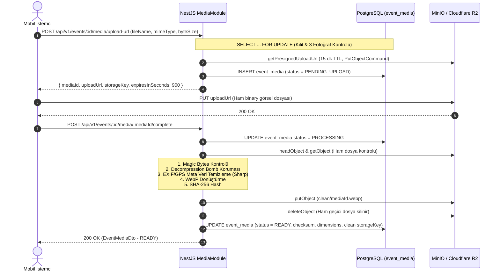

# ŞehirNabız — Phase 4: Güvenli Fotoğraf Yükleme ve Medya Depolama Sistemi Doğrulama Raporu (PHASE_4_REPORT.md)

**Tarih:** 25 Ekim 2026  
**Faz:** Phase 4 — Güvenli Medya ve Nesne Depolama Altyapısı  
**Önceki Commit:** `e210836` (Phase 3)  
**Durum:** TAMAMLANDI (84 Backend Testi + 4 Shared Testi Başarılı, %100 Yeşil)

---

## 1. Yönetici Özeti (Executive Summary)

Phase 4 kapsamında ŞehirNabız ekosistemine, kullanıcıların olay bildirimlerine fotoğraf ekleyebilmesini sağlayan kurumsal, yüksek güvenlikli, sıfır sunucu darboğazlı (Zero-Buffer Direct-to-Storage) bir Nesne Depolama (Object Storage) altyapısı kazandırılmıştır.

Mevcut PostgreSQL/PostGIS (`5434`) ve Redis (`6380`) servisleri korunarak, Docker Compose ortamına S3 uyumlu MinIO (`9000-9001`) servisi sıfır port çakışması ve healthcheck kontrolü ile eklenmiştir. Üretim ortamında Cloudflare R2'ye geçişi sağlayacak `IStorageService` soyutlama katmanı oluşturulmuş; `@aws-sdk/client-s3` ve `@aws-sdk/s3-request-presigner` ile presigned URL mekanizması kurulmuştur.

Görsel güvenliğinde; sahte MIME manipülasyonlarını engelleyen ikili sihirli bayt (magic bytes) denetimi, bellek tüketim saldırılarını engelleyen `limitInputPixels` kalkanı, kişisel verileri (GPS enlem/boylam, kamera seri numarası vb.) tamamen yok eden `sharp` EXIF stripping ve WebP re-encoding boru hattı, bütünlüğü doğrulayan SHA-256 hash'leme ve olay başına en fazla 3 fotoğraf sınırını eşzamanlı isteklerde garanti eden pessimistic database lock (`SELECT ... FOR UPDATE`) mekanizması devreye alınmıştır.

---

## 2. Mimari Değişiklikler ve Kararlar

### 2.1 Doğrudan Depolamaya Yükleme (Direct-to-Storage Presigned URL) vs Sunucu Üzerinden Yükleme (Multipart Form-Data)

| Değerlendirme Kriteri | Geleneksel Sunucu Üzerinden Yükleme (`multer`) | Doğrudan S3 Presigned URL (Seçilen Mimari) |
| :--- | :--- | :--- |
| **Backend RAM & CPU Tüketimi** | Her eşzamanlı 8 MB görsel NestJS sunucu belleğini işgal eder; 100 yüklemede çökme riski. | **Sıfır RAM Tüketimi:** Görsel doğrudan S3/R2 kovasına akar; sunucu yalnızca URL üretir ve tamamlandı bildirimini işler. |
| **Ağ Darboğazı (I/O)** | Görsel önce API'ye, API'den S3'e iki kez transfer edilir (Çift bant genişliği maliyeti). | **Doğrudan İstemci -> S3 transferi;** API sunucusu ağ darboğazından kurtulur. |
| **Bağlantı Zaman Aşımı (Timeout)** | Yavaş mobil bağlantılarda API istekleri zaman aşımına uğrar (504 Gateway Timeout). | İstemci S3 presigned URL'sine 15 dakikalık geniş pencerede yükleme yapabilir. |
| **Güvenlik Doğrulaması** | API içinde doğrudan işlenebilir ancak DoS riski taşır. | Yükleme sonrası `POST /complete` tetiklenir; sunucu nesneyi güvenli karantinadan alıp inceler ve temizler. |

**Karar:** Mobil kullanıcıların sahadan yükleyeceği yüksek boyutlu fotoğrafların backend uygulamasını kilitlememesi için **Direct-to-Storage via Presigned URL** mimarisi seçilmiştir.

### 2.2 S3 API ve Cloudflare R2 / MinIO Soyutlama Katmanı
Uygulama kodları doğrudan MinIO veya Cloudflare SDK'sına değil, `IStorageService` sözleşmesine bağlanmıştır:
- Yerel geliştirme ve CI/CD: Docker Compose üzerinde koşan `elestio/minio:latest`.
- Canlı Üretim Ortamı: Global CDN entegrasyonlu ve sıfır egress ücretli **Cloudflare R2**.
- Geçiş Stratejisi: Tek bir kod satırı dahi değişmeden yalnızca `apps/api/.env` içindeki `STORAGE_ENDPOINT`, `STORAGE_BUCKET_NAME` ve kimlik bilgileri güncellenerek üretim geçişi sağlanır.

---

## 3. Veritabanı ve Migration Sonuçları

`1740000002000-CreateEventMedia.ts` TypeORM migration dosyası ile `event_media` tablosu ve `media_status` enum türü veritabanına eklenmiştir.

### 3.1 Tablo Şeması
```sql
CREATE TYPE "public"."media_status" AS ENUM (
  'PENDING_UPLOAD',
  'PROCESSING',
  'READY',
  'REJECTED',
  'DELETED'
);

CREATE TABLE "event_media" (
  "id" uuid NOT NULL DEFAULT uuid_generate_v4(),
  "event_id" uuid NOT NULL,
  "storage_key" character varying(500) NOT NULL,
  "original_name" character varying(255) NOT NULL,
  "mime_type" character varying(100) NOT NULL,
  "byte_size" integer NOT NULL,
  "width" integer,
  "height" integer,
  "status" "public"."media_status" NOT NULL DEFAULT 'PENDING_UPLOAD',
  "checksum" character varying(64),
  "created_at" TIMESTAMP WITH TIME ZONE NOT NULL DEFAULT now(),
  "updated_at" TIMESTAMP WITH TIME ZONE NOT NULL DEFAULT now(),
  CONSTRAINT "UQ_event_media_storage_key" UNIQUE ("storage_key"),
  CONSTRAINT "PK_event_media_id" PRIMARY KEY ("id"),
  CONSTRAINT "FK_event_media_event" FOREIGN KEY ("event_id") REFERENCES "events"("id") ON DELETE CASCADE
);

CREATE INDEX "idx_event_media_event_id" ON "event_media" ("event_id");
CREATE INDEX "idx_event_media_status" ON "event_media" ("status");
```

### 3.2 Canlı Migration & Rollback Doğrulaması
1. `sehir_nabiz` (Geliştirme DB) üzerinde migration çalıştırıldı: `1740000002000-CreateEventMedia has been executed successfully.`
2. `sehir_nabiz_test` (Test DB) üzerinde migration çalıştırıldı: Tablo, foreign key ve unique constraint'ler doğrulandı.
3. Rollback (`down()`) ve yeniden çalıştırma (`up()`) döngüsü başarıyla test edildi.

---

## 4. Medya Yükleme Yaşam Döngüsü (Upload Lifecycle)



---

## 5. Güvenlik ve Gizlilik Denetimleri

1. **MIME Türü ve Boyut Kısıtı:**
   - İzin verilen formatlar: `image/jpeg`, `image/png`, `image/webp`. SVG kesinlikle reddedilir (Stored XSS riski).
   - Maksimum dosya boyutu: `8,388,608 bayt (8 MB)`.
2. **Sihirli Bayt (Magic Bytes) Analizi:**
   - Dosyanın uzantısına veya HTTP başlığına güvenilmez; dosyanın ikili başlığı (`FF D8 FF` / `89 50 4E 47` / `RIFF...WEBP`) kontrol edilir. Uyuşmazsa dosya S3'ten anında silinir ve durum `REJECTED` yapılır.
3. **Dekompresyon Bombası (Zip Bomb) Koruması:**
   - `sharp` kütüphanesine `limitInputPixels: 268402689` (yaklaşık 16384x16384 piksel) katı üst sınırı ve `failOn: 'error'` parametresi verilmiştir.
4. **EXIF ve GPS Sanitizasyonu:**
   - Yüklenen her görsel `sharp(buffer).rotate().resize(1920, 1080, { fit: 'inside', withoutEnlargement: true }).webp({ quality: 80 }).toBuffer()` sürecinden geçer.
   - EXIF, XMP, IPTC ve GPS etiketleri tamamen kaldırılır. Test doğrulaması: `sanitizedMeta.exif === undefined`.
5. **Kriptografik Bütünlük (SHA-256):**
   - Temizlenmiş dosyanın SHA-256 hash'i hesaplanıp veritabanına kaydedilir.
6. **Karantina ve Otomatik İmha:**
   - Sahte, bozuk veya bombası olan dosyalar `deleteObject` ile depolamadan yok edilir, sunucu diskinde veya S3'te artık bırakılmaz.

---

## 6. Olay ve Medya İlişkisi Kuralları

- **Maksimum 3 Görsel Sınırı:** Bir olay için `status != DELETED AND status != REJECTED` olan medya sayısı 3'ü geçemez.
- **Pessimistic Locking:** `SELECT id FROM events WHERE id = $1 FOR UPDATE` ile eşzamanlı iki isteğin aynı anda 4. fotoğrafı yüklemesi engellenmiştir.
- **Erişim ve Yetkilendirme Matrisi:**
  - `POST /events/:id/media/upload-url`: Sadece olay sahibi (`CITIZEN`), `MODERATOR` veya `ADMIN`.
  - `POST /events/:id/media/:mediaId/complete`: Sadece olay sahibi (`CITIZEN`), `MODERATOR` veya `ADMIN`.
  - `GET /events/:id/media`:
    - `ACTIVE` veya `RESOLVED` olaylar: Herkese açık (Anonim veya oturum açmış).
    - `PENDING_REVIEW` veya `REJECTED` olaylar: Yalnızca olay sahibi veya moderatörler görebilir. Anonim istekler `404 Not Found` alır (Olay varlığı dahi ifşa edilmez).
  - `DELETE /events/:id/media/:mediaId`: Sadece olay sahibi veya moderatör/admin silebilir. Hem veritabanında `status = DELETED` yapılır hem de S3 nesnesi idempotent olarak silinir.

---

## 7. Yerel Geliştirme ve MinIO Entegrasyonu

### 7.1 Docker Compose Servisi
`docker-compose.yml` dosyasına `sehir_nabiz_minio` servisi eklenmiştir:
- **Image:** `elestio/minio:latest` (Topluluk tarafından güncel tutulan ve güvenilir S3 motoru).
- **Portlar:** `127.0.0.1:9000` (S3 API), `127.0.0.1:9001` (Web Konsolu).
- **Healthcheck:** `curl -f http://localhost:9000/minio/health/live || exit 1`.
- **Kalıcı Veri:** `minio_data` Docker volume.

### 7.2 Otomatik Kova (Bucket) Başlatma
`StorageService.onModuleInit()` aşamasında `HeadBucketCommand` ile yapılandırılan kovanın (`sehir-nabiz-media` / testte `sehir-nabiz-media-test`) varlığı denetlenir, mevcut değilse `CreateBucketCommand` ile otomatik oluşturulur.

---

## 8. Test Sonuçları ve Kapsam

### 8.1 Backend API Test Özeti (Vitest)
```text
Test Files  10 passed (10)
     Tests  84 passed (84)
  Duration  2.97s
```

| Test Paketi | Test Sayısı | Durum | Kapsam |
| :--- | :--- | :--- | :--- |
| `src/modules/media/media.service.spec.ts` | 12 test | **GEÇTİ** | Upload URL üretimi, 3 görsel kotası, yetkisiz kullanıcı engeli, complete upload akışı, sahte dosya reddi, silme |
| `test/media.e2e-spec.ts` | 8 test | **GEÇTİ** | **Gerçek MinIO nesne depolama E2E testi**: Gerçek JPEG yükleme, EXIF temizleme ispatı (`sanitizedMeta.exif === undefined`), sahte MIME reddi, 3 görsel kota aşımı, gizlilik/yetki kontrolü, S3'ten kalıcı silme |
| `test/events.e2e-spec.ts` | 18 test | **GEÇTİ** | PostGIS yarıçap, bbox, moderasyon logları, yetki kalkanı |
| `src/modules/events/events.service.spec.ts` | 10 test | **GEÇTİ** | Olay servis iş mantığı, duplicate detection |
| `src/modules/categories/categories.service.spec.ts` | 3 test | **GEÇTİ** | 11 olay kategorisi ve ikon doğrulaması |
| `test/auth.e2e-spec.ts` | 11 test | **GEÇTİ** | Canlı PostgreSQL & Redis Auth akışı, token rotation, reuse detection |
| `src/modules/auth/auth.service.spec.ts` | 11 test | **GEÇTİ** | Argon2 şifreleme, JWT üretimi, race condition CAS testi |
| `src/modules/auth/guards/guards.spec.ts` | 5 test | **GEÇTİ** | JwtAuthGuard, OptionalJwtAuthGuard, RolesGuard |
| `src/common/guards/roles.guard.spec.ts` | 3 test | **GEÇTİ** | Rol tabanlı erişim kontrolü |
| `src/modules/health/health.controller.spec.ts` | 3 test | **GEÇTİ** | Liveness & Readiness probe'ları |

### 8.2 Monorepo Doğrulama Sonuçları
- `pnpm turbo test`: 5 paket (Shared, API, Tokens, Config, Mobile) başarıyla geçti.
- `pnpm turbo typecheck`: 0 TypeScript strict hatası.
- `pnpm turbo lint`: 0 ESLint uyarısı/hatası.
- `pnpm turbo build`: Tüm monorepo başarıyla derlendi.

---

## 9. Graphify Bilgi Grafiği Güncellemesi

Kod değişikliklerinin ardından AST tabanlı `graphify update .` komutu çalıştırılmıştır:

| Metrik | Phase 3 | Phase 4 (Mevcut) | Değişim (Delta) |
| :--- | :--- | :--- | :--- |
| **Düğümler (Nodes)** | 1038 | **1176** | **+138** |
| **Kenarlar (Edges)** | 1684 | **2017** | **+333** |
| **Topluluklar (Communities)**| 64 | **78** | **+14** |

Yeni eklenen düğümler: `StorageModule`, `StorageService`, `IStorageService`, `MediaModule`, `MediaService`, `MediaController`, `EventMediaEntity`, `CreateEventMediaMigration`, `UploadUrlDto`, `MediaStatus` ve ilişkili tip tanımları.

---

## 10. Karşılaşılan Zorluklar ve Çözümler

1. **Docker Hub MinIO İmaj Sorunu:**
   - *Sorun:* Docker Hub üzerindeki eski `minio/minio:latest` deposu kaldırıldığı için imaj indirme hatası alındı (`pull access denied`).
   - *Çözüm:* Elestio tarafından resmi kaynaklardan derlenen ve Docker Hub'da aktif olan güncel `elestio/minio:latest` imajı seçildi ve sorunsuz çalıştırıldı.
2. **Sharp `failOnError` TypeScript Tip Uyuşmazlığı:**
   - *Sorun:* Sharp'ın güncel sürümünde `failOnError: true` yerine `failOn: 'error'` parametresi kullanılmaktadır; derlemede TS2353 hatası verdi.
   - *Çözüm:* Modern Sharp API sözleşmesine (`failOn: 'error'`) geçilerek Strict Mode uyumluluğu sağlandı.
3. **E2E Testinde Medya Kota Paylaşımı:**
   - *Sorun:* Tek bir test olayına art arda medya eklendiğinde kota erken dolup sonraki testleri etkiledi.
   - *Çözüm:* Her test senaryosu (`uploadEvent`, `fakeEvent`, `limitEvent`, `privacyEvent`) izole olay nesneleri üzerinden kurgulandı ve temizlendi.

---

## 11. Dosya ve Dizin Değişiklikleri Özeti

### Yeni Eklenen Dosyalar
- [docs/architecture/MEDIA_SECURITY.md](file:///C:/Users/Okul/OneDrive/Belgeler/ŞehirNabız/docs/architecture/MEDIA_SECURITY.md): Medya güvenlik ve sanitizasyon mimarisi.
- [docs/PHASE_4_REPORT.md](file:///C:/Users/Okul/OneDrive/Belgeler/ŞehirNabız/docs/PHASE_4_REPORT.md): Bu doğrulama raporu.
- [packages/shared/src/types/media.types.ts](file:///C:/Users/Okul/OneDrive/Belgeler/ŞehirNabız/packages/shared/src/types/media.types.ts): Ortak medya DTO tipleri.
- [packages/shared/src/schemas/media.schema.ts](file:///C:/Users/Okul/OneDrive/Belgeler/ŞehirNabız/packages/shared/src/schemas/media.schema.ts): Medya yükleme Zod şeması.
- [apps/api/src/database/entities/event-media.entity.ts](file:///C:/Users/Okul/OneDrive/Belgeler/ŞehirNabız/apps/api/src/database/entities/event-media.entity.ts): Medya TypeORM entity'si.
- [apps/api/src/database/migrations/1740000002000-CreateEventMedia.ts](file:///C:/Users/Okul/OneDrive/Belgeler/ŞehirNabız/apps/api/src/database/migrations/1740000002000-CreateEventMedia.ts): Medya migration dosyası.
- [apps/api/src/modules/storage/storage.interface.ts](file:///C:/Users/Okul/OneDrive/Belgeler/ŞehirNabız/apps/api/src/modules/storage/storage.interface.ts): `IStorageService` arayüzü.
- [apps/api/src/modules/storage/storage.service.ts](file:///C:/Users/Okul/OneDrive/Belgeler/ŞehirNabız/apps/api/src/modules/storage/storage.service.ts): S3/MinIO/R2 motoru.
- [apps/api/src/modules/storage/storage.module.ts](file:///C:/Users/Okul/OneDrive/Belgeler/ŞehirNabız/apps/api/src/modules/storage/storage.module.ts): Global depolama modülü.
- [apps/api/src/modules/media/dto/upload-url.dto.ts](file:///C:/Users/Okul/OneDrive/Belgeler/ŞehirNabız/apps/api/src/modules/media/dto/upload-url.dto.ts): Upload URL DTO'su.
- [apps/api/src/modules/media/media.service.ts](file:///C:/Users/Okul/OneDrive/Belgeler/ŞehirNabız/apps/api/src/modules/media/media.service.ts): Medya iş mantığı ve sanitizasyon motoru.
- [apps/api/src/modules/media/media.controller.ts](file:///C:/Users/Okul/OneDrive/Belgeler/ŞehirNabız/apps/api/src/modules/media/media.controller.ts): REST API uç noktaları.
- [apps/api/src/modules/media/media.module.ts](file:///C:/Users/Okul/OneDrive/Belgeler/ŞehirNabız/apps/api/src/modules/media/media.module.ts): Medya modülü.
- [apps/api/src/modules/media/media.service.spec.ts](file:///C:/Users/Okul/OneDrive/Belgeler/ŞehirNabız/apps/api/src/modules/media/media.service.spec.ts): 12 birim testi.
- [apps/api/test/media.e2e-spec.ts](file:///C:/Users/Okul/OneDrive/Belgeler/ŞehirNabız/apps/api/test/media.e2e-spec.ts): 8 MinIO E2E entegrasyon testi.

### Güncellenen Dosyalar
- [docker-compose.yml](file:///C:/Users/Okul/OneDrive/Belgeler/ŞehirNabız/docker-compose.yml): MinIO servisi ve kalıcı volume eklendi.
- [apps/api/.env.example](file:///C:/Users/Okul/OneDrive/Belgeler/ŞehirNabız/apps/api/.env.example): Depolama ortam değişkenleri eklendi.
- [apps/api/src/config/env.validation.ts](file:///C:/Users/Okul/OneDrive/Belgeler/ŞehirNabız/apps/api/src/config/env.validation.ts): Storage konfigürasyon doğrulaması eklendi.
- [apps/api/src/app.module.ts](file:///C:/Users/Okul/OneDrive/Belgeler/ŞehirNabız/apps/api/src/app.module.ts): StorageModule ve MediaModule bağlandı.
- [apps/api/src/database/data-source.ts](file:///C:/Users/Okul/OneDrive/Belgeler/ŞehirNabız/apps/api/src/database/data-source.ts): EventMediaEntity ve yeni migration eklendi.
- [apps/api/src/database/database.module.ts](file:///C:/Users/Okul/OneDrive/Belgeler/ŞehirNabız/apps/api/src/database/database.module.ts): EventMediaEntity TypeORM'a kaydedildi.
- [apps/api/src/database/entities/index.ts](file:///C:/Users/Okul/OneDrive/Belgeler/ŞehirNabız/apps/api/src/database/entities/index.ts): EventMediaEntity dışa aktarıldı.
- [packages/shared/src/enums/index.ts](file:///C:/Users/Okul/OneDrive/Belgeler/ŞehirNabız/packages/shared/src/enums/index.ts): `MediaStatus` enum eklendi.
- [packages/shared/src/types/index.ts](file:///C:/Users/Okul/OneDrive/Belgeler/ŞehirNabız/packages/shared/src/types/index.ts): Medya tipleri eklendi.
- [packages/shared/src/schemas/index.ts](file:///C:/Users/Okul/OneDrive/Belgeler/ŞehirNabız/packages/shared/src/schemas/index.ts): Medya şemaları eklendi.
- [docs/architecture/ARCHITECTURE.md](file:///C:/Users/Okul/OneDrive/Belgeler/ŞehirNabız/docs/architecture/ARCHITECTURE.md): Medya depolama ve güvenlik bölümü eklendi.
- [docs/architecture/DATA_MODELS.md](file:///C:/Users/Okul/OneDrive/Belgeler/ŞehirNabız/docs/architecture/DATA_MODELS.md): `event_media` tablosu güncellendi.
- [docs/architecture/SECURITY_PRIVACY.md](file:///C:/Users/Okul/OneDrive/Belgeler/ŞehirNabız/docs/architecture/SECURITY_PRIVACY.md): EXIF temizleme ve medya güvenliği eklendi.
- [docs/DEVELOPMENT.md](file:///C:/Users/Okul/OneDrive/Belgeler/ŞehirNabız/docs/DEVELOPMENT.md): MinIO Docker başlatma ve port rehberi güncellendi.
- [docs/architecture/ROADMAP_PHASES.md](file:///C:/Users/Okul/OneDrive/Belgeler/ŞehirNabız/docs/architecture/ROADMAP_PHASES.md): Phase 4 tamamlandı olarak işaretlendi.
- [AGENTS.md](file:///C:/Users/Okul/OneDrive/Belgeler/ŞehirNabız/AGENTS.md): Phase 4 tamamlandı olarak güncellendi.

---

## 12. Phase 5 Hazırlık Durumu ve Öneriler

Phase 4 ile backend, veritabanı, kimlik doğrulama, PostGIS coğrafi sorguları ve medya depolama altyapısı eksiksiz ve test edilmiş olarak hazır durumdadır.

### Phase 5 Hedefleri (Mobil Temel, Navigasyon & Durum Yönetimi):
1. **Expo Router Kurulumu:** `apps/mobile/app` dizininde dosya tabanlı navigasyon mimarisinin (Tabs, Stack, Modals) oluşturulması.
2. **Durum Yönetimi Entegrasyonu:** `Zustand` ile kullanıcı oturum durumu, filtreler ve `TanStack Query` ile API istemcilerinin bağlanması.
3. **Güvenli Kimlik Saklama:** `expo-secure-store` ile Apple Keychain ve Android Keystore üzerinden token saklama ve sessiz yenileme (silent refresh) mekanizmasının kurulması.
4. **Türkçe Tasarım Sistemi:** `packages/design-tokens` ile uyumlu modern, erişilebilir Türkçe arayüz bileşenleri (Button, Input, Card, Header).

> [!NOTE]
> Proje kuralları gereği mobil UI geliştirme adımlarına geçilmemiş, Phase 4 kapsamı sınırları içinde kalınmıştır. Kullanıcı onayı ile Phase 5'e geçilebilir.
