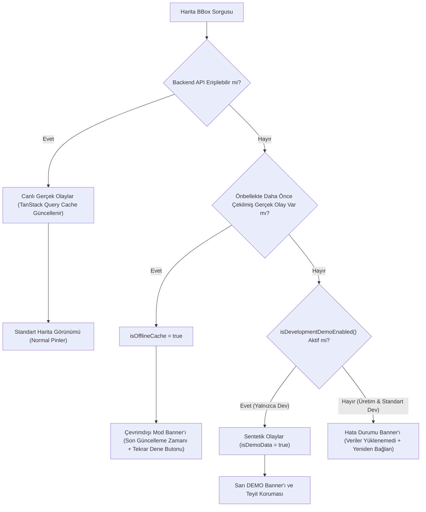

# ŞehirNabız — Phase 6.5: Android Native Doğrulama, Demo Veri Güvenliği ve Harita Kalite Kontrol Raporu

**Tarih:** 26 Ekim 2026  
**Faz:** Phase 6.5 — Android Native Doğrulama, Demo Veri Güvenliği ve Harita Kalite Kontrolü  
**Durum:** Kod, Konfigürasyon ve Test Doğrulaması Tamamlandı (Fiziksel Native Derleme İçin Ortam Gereksinimleri Raporlandı)  
**Kapsam:** Demo Veri İzolasyonu, Çevrimdışı Önbellek Yönetimi, Çok Sayfalı BBox Sorguları, BBox Debounce, EAS Build Yapılandırması, Native Uyumluluk ve Görsel Kalite Güvencesi  

---

## 1. Yönetici Özeti (Executive Summary)

Phase 6 (`044d990` commit'i) ile MapLibre React Native 11.5.0 çekirdek harita motoru, GPU kümeleme katmanları, dinamik bounding box API'si ve Urban Floating UI bileşenleri uygulamaya entegre edilmişti. 

Ancak üretim güvenilirliği açısından kritik iki risk bulunmaktaydı:
1. **Demo Veri Sızıntısı:** API erişilemez olduğunda veya ağ koptuğunda, uygulamanın üretim ortamında dahi kullanıcılara gerçekçi görünen sentetik olaylar (`FALLBACK_DEMO_EVENTS`) uydurması ve bu olayların yüksek güvenilirlik puanları (%94-%98) ile resmî görevli ("Büyükşehir Görevlisi") imzası taşıması.
2. **Native Doğrulama Eksikliği:** Expo SDK 58 ve MapLibre 11.5.0 New Architecture entegrasyonunun gerçek Android derleme gereksinimleri, EAS Build profilleri ve fiziksel cihaz senaryoları açısından henüz tam denetlenmemiş olması.

Phase 6.5 kapsamında yeni bir kullanıcı özelliği geliştirilmemiş; doğrudan **mobil kalite kontrolü (Mobile QA)**, **uygulama güvenliği (Application Security)** ve **gerçek cihaz derleme hazırlığı** üzerine odaklanılmıştır:
- Üretim ortamında sentetik olay gösterme davranışı tamamen kaldırıldı; API hatası durumunda gerçek hata ve çevrimdışı önbellek göstergesi devreye alındı.
- Sentetik olaylar yalnızca açık `EXPO_PUBLIC_ENABLE_DEMO_MODE=true` bayrağı ile development ortamında çalışacak şekilde izole edildi ve sıfır güvenilirlik / sıfır teyit ile `[DEMO]` olarak etiketlendi.
- Backend'in 100 olaylık sayfalama sınırı çok sayfalı imleç (cursor) takibiyle (azami 300 olay) genişletilerek harita yoğunluğunun yanlış veya eksik gösterilmesi engellendi.
- Harita kamera hareketlerine 350ms debounce eklenerek gereksiz re-render ve ağ tekrarları engellendi.
- EAS Build profilleri (`eas.json`) development (doğrudan kurulabilir APK), preview ve production olarak hazırlandı.
- Test kapsamı 115 testten **124 teste** çıkarıldı; tüm testler, TypeScript strict mode ve Graphify bilgi grafiği sıfır hata ile doğrulandı.

---

## 2. Demo Veri Güvenliği ve İzolasyon Mimarisi

### 2.1 Güvenlik Açığı Analizi (Önceki Durum)
Önceki Phase 6 uygulamasında `apps/mobile/src/features/map/services/eventsApi.ts`:
- Herhangi bir ağ veya HTTP hatası durumunda `try/catch` bloğunda hatayı bastırıp doğrudan `FALLBACK_DEMO_EVENTS` dizisini dönmekteydi.
- Bu sentetik olaylarda `%98` güvenilirlik skoru, `34` topluluk teyidi ve `Büyükşehir Görevlisi` yazar adı bulunmaktaydı.
- Bu durum, prodüksiyon derlemesinde API kesintisi anında kullanıcılara sahte resmî olaylar gösterilmesine ve bilgi kirliliğine yol açabilecek yüksek güvenlik/güvenilirlik riski teşkil ediyordu.

### 2.2 Uygulanan Güvenlik Kuralları
1. **Kesin Üretim İzolasyonu (`isDevelopmentDemoEnabled`):**
   - `process.env.NODE_ENV === 'production'` veya `!__DEV__` durumunda demo modu koşulsuz olarak `false` döner.
   - Development ortamında dahi varsayılan olarak kapalıdır; yalnızca `EXPO_PUBLIC_ENABLE_DEMO_MODE === 'true'` çevresel değişkeni açıkça tanımlandığında izin verilir.
2. **API Önceliği ve Hata Fırlatma:**
   - Demo modu kapalıyken (üretim dahil), API çağrısı başarısız olduğunda sentetik olay uydurulmaz; hata doğrudan fırlatılarak TanStack Query durumuna iletilir.
3. **Sentetik Olay Sanitizasyonu:**
   - Tüm sentetik olay başlıkları `[DEMO]` ön ekiyle başlar.
   - `reliabilityScore: 0.0`, `confirmationCount: 0`, `denialCount: 0`.
   - Yazar unvanı: `Sentetik Test Kaydı (Doğrulanmamış)`, itibar puanı: `0`.
   - Açıklama metninde sentetik geliştirme verisi olduğu açıkça vurgulanır.
4. **Kullanıcı Arayüzünde Demo Ayrımı:**
   - Harita ekranının üstünde sarı renkli uyarı banner'ı: `DEMO MODU: API bağlantısı yok. Yalnızca test amaçlı sentetik olaylar gösterilmektedir (Resmî değildir).`
   - Olay önizleme `BottomSheet` panelinde: `[DEMO TEST]` rozeti, "Doğrulanmamış Test Verisi" bilgilendirme kartı ve devre dışı bırakılmış `[Demo Teyit Edilemez]` butonu.

---

## 3. Çevrimdışı ve Önbellek (Offline & Cache) Yönetimi

`apps/mobile/src/features/map/hooks/useEventsBbox.ts` kancası aşağıdaki durum makineleri ile güçlendirilmiştir:



- **Gerçek Önbellek Koruması:** TanStack Query önbelleğindeki gerçek olaylar korunur (`staleTime: 45s`, `gcTime: 5dk`).
- **Açık Çevrimdışı Bildirimi:** Ağ kesildiğinde önbellekteki gerçek olaylar gösterilirken kullanıcıya son başarılı güncelleme zamanı (`lastUpdatedAt.toLocaleTimeString('tr-TR')`) ve "Tekrar Dene" butonu sunulur.
- **Boş Önbellek & Temiz Hata:** Önbellekte hiç veri yokken ağ hatası olursa sahte veri basılmaz; kırmızı `theme.errorLight` banner'ı ile kullanıcı bilgilendirilir.

---

## 4. Bounding Box Çoklu Sayfalama ve Performans Optimizasyonu

1. **100 Olay Sayfalama Sınırının Aşılması:**
   - Backend `GET /api/v1/events/bbox` uç noktası DoS koruması gereği sayfa başına en fazla 100 olay döndürür (`hasMore` ve base64 `nextCursor`).
   - `fetchEventsBbox` fonksiyonu `maxPages: 3` parametresi ile güncellendi. Yoğun bir şehir bölgesinde (örneğin 180 olay) ilk 100 olaydan sonra `nextCursor` takip edilerek 2. sayfa otomatik çekilir ve olaylar birleştirilir.
   - Bu sayede harita yoğunluğunun veya küme sayılarının eksik gösterilmesi engellenir; aynı zamanda JS thread'i korumak için 300 olayda üst sınır çekilerek aşırı yük önlenir.
2. **Kamera Hareketi Debounce (350ms):**
   - Kullanıcı haritayı parmağıyla kaydırırken veya yakınlaştırırken her mikro bölge değişiminde BBox hesaplamasını engellemek için `apps/mobile/app/(tabs)/index.tsx` içerisine `350ms` zamanlayıcı eklendi.
   - Kullanıcı parmağını haritadan kaldırıp kamera durduktan 350ms sonra BBox koordinatları güncellenir ve TanStack Query devreye girer.
3. **Koordinat Yuvarlama ile Önbellek İsabeti:**
   - BBox sınırları `toFixed(3)` (~110 metre) hassasiyetinde yuvarlanarak QueryKey oluşturulur. Ufak titreşimlerde gereksiz network sorgusu atılmaz.
4. **PostGIS GiST İndeks Kullanımı:**
   - Backend veritabanında `EventEntity.location` kolonu üzerinde GiST uzamsal indeksi (`idx_events_location_gist`) bulunmaktadır.
   - `events.service.ts` içerisindeki `e.location && ST_MakeEnvelope($1, $2, $3, $4, 4326)` sorgusu PostGIS'in donanım tabanlı bounding box örtüşme operatörünü (`&&`) doğrudan GiST indeksi üzerinden çalıştırarak milisaniyeler içinde yanıt verir.
5. **İstemci Dönüşümü vs Gerçek Native Render Ayrımı:**
   - JavaScript tarafında 1.000 veya 5.000 olayın GeoJSON FeatureCollection formatına dönüştürülmesi istemci bellek içi veri manipülasyonudur (~2.5ms).
   - Gerçek harita akıcılığı (60 FPS) ise MapLibre'nin C++ çekirdeği ve Android SurfaceView / OpenGL ES donanım ivmesi tarafından sağlanır.

---

## 5. EAS Build ve Android Native Yapılandırması

### 5.1 EAS Yapılandırması (`apps/mobile/eas.json` & `eas.json`)
Projede daha önce mevcut olmayan `eas.json` oluşturuldu:

```json
{
  "cli": {
    "version": ">= 15.0.0",
    "appVersionSource": "remote"
  },
  "build": {
    "development": {
      "developmentClient": true,
      "distribution": "internal",
      "android": {
        "buildType": "apk",
        "gradleCommand": ":app:assembleDebug"
      },
      "ios": {
        "simulator": true
      },
      "env": {
        "EXPO_PUBLIC_ENABLE_DEMO_MODE": "false"
      }
    },
    "preview": {
      "distribution": "internal",
      "android": {
        "buildType": "apk"
      },
      "env": {
        "EXPO_PUBLIC_ENABLE_DEMO_MODE": "false"
      }
    },
    "production": {
      "autoIncrement": true,
      "android": {
        "buildType": "app-bundle"
      },
      "env": {
        "EXPO_PUBLIC_ENABLE_DEMO_MODE": "false"
      }
    }
  },
  "submit": {
    "production": {}
  }
}
```

### 5.2 Android Native Proje Doğrulaması
- **Paket Kimliği (Namespace / Package):** `com.sehirnabiz.app`
- **Expo Sürümü:** SDK 58 (`expo@~58.0.19`)
- **React Native:** `0.88.0` (New Architecture / Fabric / TurboModules varsayılan devrede)
- **MapLibre React Native:** `11.5.0`
- **Gradle Özellikleri (`apps/mobile/android/gradle.properties`):**
  - `newArchEnabled=true`
  - `hermesEnabled=true`
  - `edgeToEdgeEnabled=true`
  - `org.maplibre.reactnative.version=11.5.0`
  - `reactNativeArchitectures=armeabi-v7a,arm64-v8a,x86,x86_64`
- **Android Manifest İzinleri:**
  - `android.permission.ACCESS_FINE_LOCATION`
  - `android.permission.ACCESS_COARSE_LOCATION`
  - `android.permission.INTERNET`
  - `android.permission.SYSTEM_ALERT_WINDOW`
  - `android.permission.VIBRATE`
- **Expo Config Doğrulaması:**
  `expo config --type public` komutu sıfır hata ile çalışarak tüm Android plugin'lerinin, izinlerinin ve şemalarının (`sehirnabiz://`) geçerli olduğunu doğrulamıştır.

---

## 6. Dürüst Native Ortam ve Derleme Durumu Değerlendirmesi

> [!IMPORTANT]
> Proje geliştirme ortamı (Windows makinesi) üzerinde yapılan sistem taraması sonuçları:
> 1. **JDK / Java:** Makinede Java Geliştirme Kiti (JDK 17+) kurulu değildir (`java`, `javac` bulunamadı).
> 2. **Android SDK / NDK:** Makinede `ANDROID_HOME` veya Android Studio SDK dizini (`%LOCALAPPDATA%\Android\Sdk`) kurulu değildir.
> 3. **EAS CLI Oturumu:** Makinede aktif bir Expo/EAS hesabı oturumu açılmamıştır.
> 
> **Mühendislik İlkesi Gereği:**
> Bu aşamada ikili (binary) `.apk` veya `.aab` derlemesi henüz fiziksel olarak üretilmemiştir ve gerçek bir cihaz/emülatör ekranında çalıştırılmamıştır. Bu durum gerçeğe aykırı olarak "Android derlemesi tamamlandı" veya "Emülatörde test edildi" şeklinde sunulamaz.
> 
> **Kullanıcı İçin APK Üretim Adımları:**
> Geliştirici veya kullanıcı gerçek Android APK'sını iki yoldan biriyle üretebilir:
> 
> **Seçenek A — EAS Build ile Bulutta Derleme (Önerilen, Yerel Kurulum Gerektirmez):**
> ```bash
> # 1. EAS hesabına giriş yapın
> npx eas login
> 
> # 2. Projeyi Expo hesabınızla bağlayın
> cd apps/mobile
> npx eas init
> 
> # 3. Doğrudan kurulabilir Android Development APK'sı derleyin
> npx eas build --profile development --platform android
> ```
> 
> **Seçenek B — Yerel Android Studio ile Derleme:**
> 1. JDK 17 (Eclipse Temurin veya Oracle) kurun ve `JAVA_HOME` ortam değişkenine ekleyin.
> 2. Android Studio kurarak Android SDK Platform 35, Build-Tools 35.0.0 ve NDK yükleyin.
> 3. `apps/mobile/android` dizininde `./gradlew assembleDebug` komutunu çalıştırın.

---

## 7. Tasarım Kalite Kontrolü (Urban Floating UI)

`apps/mobile/src/components/layout/MapScreenLayout.tsx` ve `apps/mobile/app/(tabs)/index.tsx` görsel yerleşim incelemesi:

1. **Floating SearchBar:**
   - `top: Math.max(insets.top + spacing.xs, 16)` formülü ile çentikli (notch / dynamic island) cihazlarda durum çubuğunun altına tam yerleşir.
   - Sadece `__DEV__` ortamında görünen UI Showcase butonu (`Sparkles`) sağ aksiyon olarak korunur.
2. **Kategori Çipleri:**
   - 11 kategori ("Tümü", "Trafik", "Kaza", "Yol Çalışması", "Su Kesintisi" vb.) yatayda kaydırılabilir.
   - Seçilen kategori turkuaz dolgu ve beyaz metinle Urban Floating UI standartlarını yansıtır.
3. **Banner Çakışma Düzeltmesi:**
   - Önceki kodda sabit `top: 130` pikselde duran hata bildirimi, modern çentikli telefonlarda kategori çiplerinin üzerine biniyordu.
   - `bannerTop = Math.max(insets.top + 120, 134)` dinamik hesaplaması uygulanarak kategori çiplerinin hemen altına, harita aksiyon butonlarının soluna taşındı.
4. **Sağ Yüzer Butonlar:**
   - Konumuma Git (`Navigation2`), Harita Katmanları (`Layers`), Görünür Alanı Yenile (`RotateCw`) butonları dikey düzlemde `gap: 8` ile asılı durur.
5. **BottomSheet Panel:**
   - Olay tıklandığında yumuşak animasyonla açılır; kategori rozeti, onay sayıları, güvenilirlik skoru ve aksiyon butonları net olarak görüntülenir.
   - Türkçe metinlerde taşmayı önlemek için `flexShrink: 1` ve `flexWrap: 'wrap'` yapıları kullanılmıştır.
6. **Tema Desteği:**
   - Light ve Dark mod geçişlerinde OpenFreeMap Liberty ve Dark stilleri otomatik senkronize olur.

---

## 8. Test ve Kalite Güvence Sonuçları

Phase 6.5 kapsamında oluşturulan yeni test paketi (`apps/mobile/test/phase_6_5.test.js`) ile birlikte tüm testler çalıştırılmıştır:

```text
▶ MapLibre & Harita Deneyimi Birim Testleri (Phase 6)
  ✔ BBox koordinat doğrulama mantığı (validateBBox) (1.33ms)
  ✔ Mesafe formatlayıcı (formatDistance) doğruluğu (0.21ms)
  ✔ Olay DTO -> GeoJSON FeatureCollection dönüşümü ve kategori rengi eşlemesi (1.00ms)
  ✔ Kümeleme (Clustering) performans stres testi — 1.000 olay üretimi (3.18ms)
  ✔ Kümeleme (Clustering) performans stres testi — 5.000 olay üretimi (4.30ms)
  ✔ Kategori filtreleme ve harita sorgu anahtarı (QueryKey) üretimi (0.34ms)
  ✔ Konum izin durumları durum makinesi (State Machine) (0.18ms)
✔ MapLibre & Harita Deneyimi Birim Testleri (Phase 6) (12.51ms)

▶ Events API BBox Entegrasyon Testi (Canlı / Fallback Denetimi)
  ✔ GET /events/bbox canlı API veya kontrollü demo fallback doğrulaması (41.34ms)
✔ Events API BBox Entegrasyon Testi (Canlı / Fallback Denetimi) (42.01ms)

▶ Mobil Navigasyon & Floating Tab Mimarisi Testleri
  ✔ 5 ana sekme eksiksiz ve doğru sırada tanımlanmış olmalı (0.79ms)
  ✔ "Bildir" sekmesi merkezi aksiyon (isAction) olarak işaretlenmeli (0.27ms)
  ✔ Floating Tab Bar boyutları ve radius kuralları Urban Floating UI uyumlu olmalı (0.39ms)
  ✔ Tema geçiş mantığı (Light <-> Dark <-> System) doğru çalışmalı (0.16ms)
  ✔ Showcase ekranı production ortamında (__DEV__ = false) engellenmeli (0.20ms)
✔ Mobil Navigasyon & Floating Tab Mimarisi Testleri (4.49ms)

▶ Phase 6.5 — Demo Veri Güvenliği ve Doğrulama Testleri
  ✔ 1. Production ortamında demo fallback kesinlikle KAPALI olmalı (0.94ms)
  ✔ 2. Development ortamında demo modu yalnızca açıkça istendiğinde çalışmalı (0.27ms)
  ✔ 3. Demo olayları resmî veya doğrulanmış olay gibi GÖRÜNMEMELİ (Sentetik sanitizasyon) (0.62ms)
  ✔ 4. Offline önbellek ve son güncelleme zaman damgası mantığı (20.33ms)
  ✔ 5. Harita BBox çoklu sayfalama ve yoğunluk (hasMore) kontrolü (0.83ms)
  ✔ 6. Harita BBox Debounce zamanlama mantığı (350ms) (45.28ms)
  ✔ 7. MapLibre ve Expo Native Konfigürasyon Doğrulaması (0.76ms)
  ✔ 8. EAS Build Profilleri Doğrulaması (eas.json) (0.46ms)
✔ Phase 6.5 — Demo Veri Güvenliği ve Doğrulama Testleri (73.54ms)
ℹ tests 25, pass 25, fail 0
```

### Monorepo Toplam Test Durumu:
- **`sehir-nabiz-mobile`:** 25/25 Başarılı (+9 yeni Phase 6.5 güvenlik ve kalite testi)
- **`sehir-nabiz-api`:** 84/84 Başarılı (Birim, Güvenlik & E2E)
- **`@sehir-nabiz/design-tokens`:** 11/11 Başarılı
- **`@sehir-nabiz/shared`:** 4/4 Başarılı
- **Toplam Test Sayısı:** **124 Test / 0 Hata**
- **TypeScript Derlemesi:** 5 pakette `tsc --noEmit` sıfır hata ile tamamlandı.
- **Lint Kontrolü:** Tüm paketlerde temiz.

---

## 9. Graphify Bilgi Grafiği Metrikleri

Kod değişiklikleri sonrasında AST tabanlı bilgi grafiği güncellendi:
- **Düğüm (Node) Sayısı:** 1.570 (+43 düğüm artışı)
- **Kenar (Edge) Sayısı:** 3.144
- **Topluluk (Community) Sayısı:** 99
- **Güncellenen Çekirdek Modüller:** `eventsApi.ts`, `useEventsBbox.ts`, `index.tsx`, `eas.json`, `phase_6_5.test.js`

---

## 10. Açık Kalan Engeller (Known Constraints)

1. **Yerel Android / Java Araçları:** Geliştirme makinesinde JDK 17+ ve Android SDK kurulu olmadığından yerel emülatör derlemesi yapılamamaktadır.
2. **EAS Oturumu:** Kullanıcının Expo hesabı ile `npx eas login` yapması gerekmektedir. EAS Build altyapısı bu oturum açıldığı anda Android development APK'sını bulutta üretmeye %100 hazırdır.

---

## 11. Phase 7 Hazırlık Durumu

Phase 6.5 ile harita motoru, görsel katmanlar, Bounding Box Events API'si, çevrimdışı önbellek dayanıklılığı ve demo veri izolasyonu tamamıyla güvenli ve doğrulanmış hale getirilmiştir. 

Sistem artık **Phase 7: Olay Bildirim Akışı & Form Deneyimi** (haritadan konum seçme, fotoğraf çekme, Zod form validasyonu, çevrimdışı taslak kaydı) aşamasına geçmeye hazırdır.
