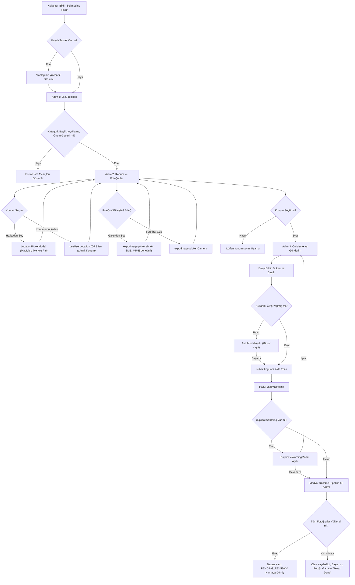

# ŞehirNabız — Phase 7 Kapanış ve Doğrulama Raporu (PHASE_7_REPORT.md)

**Rapor Tarihi:** 26 Ekim 2026  
**Aşama:** Phase 7 — Premium Olay Bildirme Akışı, Konum Seçimi ve Fotoğraf Yükleme  
**Durum:** Başarıyla Tamamlandı (136/136 Test Başarılı, %100 Tip Güvenliği)

---

## 1. Yönetici Özeti ve Faz Hedefleri

Phase 7 kapsamında, ŞehirNabız mobil uygulamasının "Bildir" sekmesi (`/(tabs)/create`), kullanıcıların kentteki aksaklıkları (kaza, yol çalışması, su/elektrik arızaları vb.) hızla, güvenli ve sezgisel bir şekilde bildirebildiği uçtan uca profesyonel 3 adımlı bir akışa dönüştürülmüştür.

Bu fazın temel başarı kriterleri:
- **Urban Floating UI Standartları:** Turkuaz `#14B8A6` marka rengi, beyaz yüzen kartlar, 16–20px radius, yumuşak derinlikli gölgeler ve Lucide ikonları ile tasarım bütünlüğü.
- **3 Aşamalı Sihirbaz Akışı:** Kullanıcıyı yormayan Adım 1 (Olay Bilgileri), Adım 2 (Konum ve Fotoğraflar) ve Adım 3 (Önizleme ve Gönderim).
- **MapLibre İnteraktif Konum Seçimi:** `LocationPickerModal` ile harita merkezinde sabit hedef iğnesi (pin), akıcı pan/zoom, GPS konumu alma ve 5 basamaklı koordinat hassasiyeti.
- **Güvenli ve Kısıtlı Fotoğraf Seçimi:** `expo-image-picker` ile kamera/galeri seçimi, azami 3 adet fotoğraf, 8 MB dosya boyutu sınırı, JPEG/PNG/WebP format doğrulaması.
- **3 Adımlı Medya API Pipeline'ı:** `POST /upload-url` -> MinIO/S3 presigned PUT -> `POST /complete` entegrasyonu; kısmi fotoğraf yükleme hatalarında olay kimliği (ID) korunarak görsel bazında "Tekrar Dene" imkânı.
- **Güvenli Kimlik Doğrulama Kalkanı:** Misafir kullanıcıların formu doldurmasına izin verip gönderim anında devreye giren `AuthModal`, in-memory access token, `expo-secure-store` donanım şifreli refresh token ve eşzamanlı istek yarış durumlarını engelleyen Promise-tabanlı mutex kilidi.
- **Yerel Taslak ve Kalıcı Dosya Yönetimi:** Yazarken otomatik kaydedilen form verileri ve geçici önbellekten (`cacheDirectory`) kalıcı doküman dizinine (`documentDirectory`) güvenle kopyalanan fotoğraflar.
- **Mükerrer Bildirim Uyarısı:** 150m yarıçapta 45 dakika içinde benzer olay sezildiğinde kullanıcıya bildirimde bulunan `DuplicateWarningModal`.

---

## 2. Oluşturulan Ekranlar ve Bileşen Mimarisi

Phase 7 ile oluşturulan ve güncellenen modüller `apps/mobile/src/features/events/` ve `apps/mobile/src/features/auth/` altında modüler atomic mimariye uygun olarak geliştirilmiştir:

```text
apps/mobile/
├── app/(tabs)/create.tsx              # CreateEventFlow ana rotası
└── src/
    ├── config/
    │   └── env.ts                     # getApiBaseUrl() (Android emülatör 10.0.2.2 desteği)
    ├── features/
    │   ├── auth/
    │   │   ├── components/
    │   │   │   └── AuthModal.tsx      # Giriş ve Kayıt sekmeli yüzer modal
    │   │   ├── services/
    │   │   │   ├── authApi.ts         # Login, Register, Refresh, Me uç noktaları
    │   │   │   └── secureTokenStorage.ts # expo-secure-store şifreli token saklama
    │   │   ├── store/
    │   │   │   └── useAuthStore.ts    # Access token ve refresh mutex Zustand store'u
    │   │   └── index.ts
    │   └── events/
    │       ├── components/
    │       │   ├── CreateEventFlow.tsx # 3 adımlı sihirbaz ve durum yönetimi
    │       │   ├── LocationPickerModal.tsx # MapLibre tam ekran konum seçici
    │       │   ├── PhotoPickerSection.tsx # Galeri/Kamera, kartlar ve retry
    │       │   └── DuplicateWarningModal.tsx # Mükerrer olay uyarı penceresi
    │       ├── services/
    │       │   ├── categoriesApi.ts   # GET /categories (dinamik 11 kategori)
    │       │   ├── draftService.ts    # Kalıcı taslak ve görsel kopyalama
    │       │   ├── eventsCreateApi.ts # POST /events uç noktası
    │       │   └── mediaUploadService.ts # Presigned S3 yükleme pipeline'ı
    │       ├── types/
    │       │   └── events.types.ts    # Taslak, fotoğraf, konum ve adım tipleri
    │       └── index.ts
```

---

## 3. Navigasyon ve Ekran Akışı

Form deneyimi, kullanıcının bilişsel yükünü azaltmak amacıyla 3 aşamaya ayrılmıştır:



---

## 4. Form Doğrulama ve Shared DTO Uyumu

Frontend validasyonu, backend ile birebir aynı kuralları (`@sehir-nabiz/shared`) işletir:

| Alan Adı | Tip / Kural | Backend Şeması | İstemci Hata Mesajı |
| :--- | :--- | :--- | :--- |
| **Kategori** | 11 Geçerli Enum | `EventCategorySchema` | "Lütfen bir kategori seçiniz." |
| **Başlık** | Metin, 5–100 Karakter | `CreateEventInputSchema.title` | "Olay başlığı en az 5, en fazla 100 karakter olmalıdır." |
| **Açıklama** | Metin, 10–1000 Karakter | `CreateEventInputSchema.description` | "Açıklama en az 10 karakter olmalıdır." |
| **Önem Derecesi** | LOW, MEDIUM, HIGH, CRITICAL | `EventSeveritySchema` | "Geçerli bir önem derecesi seçiniz." |
| **Konum (Enlem)** | -90 ile +90 arası ondalık | `GeoCoordinateSchema.latitude` | "Geçerli bir konum seçiniz." |
| **Konum (Boylam)** | -180 ile +180 arası ondalık | `GeoCoordinateSchema.longitude` | "Geçerli bir konum seçiniz." |
| **Fotoğraf Adedi** | 0 ile 3 adet arası | `MediaUploadUrlDto` kotası | "En fazla 3 fotoğraf ekleyebilirsiniz." |
| **Fotoğraf Boyutu** | Maksimum 8 MB (8.388.608 bayt) | `MediaUploadUrlDto.fileSize` | "Fotoğraf boyutu 8 MB'tan büyük olamaz." |
| **Fotoğraf Formatı**| JPEG, PNG, WebP | `MediaUploadUrlDto.mimeType` | "Yalnızca JPEG, PNG veya WebP formatı desteklenir." |

---

## 5. Haritadan Konum Seçimi (`LocationPickerModal`)

- **MapLibre Tuvali:** Harita `@maplibre/maplibre-react-native` bileşeni ile GPU ivmeli olarak çalışır.
- **Merkez Hedef Pini:** Haritanın tam ortasında dikey olarak 36px yukarı kaldırılmış bir hedef ikonu ve zemin gölgesi konumlandırılmıştır.
- **BBox / Koordinat Çözümleme:** Harita pan veya zoom ile hareket ettirildiğinde `onRegionDidChange` dinlenir; `event.nativeEvent.bounds` üzerinden merkez koordinat hesaplanır ve ekranın üstündeki yüzen koordinat çubuğunda 5 ondalık hassasiyetle (`35.48530, 38.72250`) anlık gösterilir.
- **Konumumu Kullan:** İsteğe bağlı olarak GPS izni talep edilir ve harita yumuşak bir kamera hareketi ile kullanıcının bulunduğu noktaya uçar.
- **Navigasyon Güvenliği:** Konum seçimi sırasında alt tab navigasyonu gizlenir, böylece ekran butonlarıyla tab barın çakışması engellenir.

---

## 6. Fotoğraf Seçimi ve Medya Pipeline'ı

- **İzin İdaresi:** Galeri ve kamera izinleri baştan değil, kullanıcı ilgili eylem butonuna dokunduğunda (`requestMediaLibraryPermissionsAsync` / `requestCameraPermissionsAsync`) talep edilir. Kullanıcı izin vermezse olay fotoğrafsız olarak bildirilebilir.
- **Önizleme Kartları:** Her görsel 80x80px kart üzerinde dosya boyutu etiketi (`1.4 MB`), silme ikonu ve yükleme durum göstergesiyle sunulur.
- **3 Aşamalı Yükleme:**
  1. `POST /api/v1/events/:id/media/upload-url` ile MinIO/S3 için presigned PUT URL'i ve `mediaId` üretilir.
  2. Native tarafta `FileSystem.uploadAsync` (veya web üzerinde binary `fetch`) ile görsel doğrudan nesne depolama sunucusuna yüklenir.
  3. `POST /api/v1/events/:id/media/:mediaId/complete` çağrılarak dosyanın bütünlüğü ve Sharp EXIF temizleme süreci tamamlanır.
- **Kısmi Hata Koruması:** Fotoğraf yüklemesinde ağ koparsa oluşturulan olay kaydı silinmez; kullanıcıya başarısız olan görsel için "Tekrar Dene" butonu sağlanır.

---

## 7. Kimlik Doğrulama, Token ve Mutex Koruması

- **Misafir Kullanıcı Desteği:** Kullanıcılar formu doldurabilir, konum ve fotoğraf seçebilir; ancak backend `POST /api/v1/events` uç noktası `JwtAuthGuard` ile korunduğu için gönderim öncesinde `AuthModal` tetiklenir.
- **Token Güvenliği:**
  - `accessToken`: Bellekte (Zustand state) tutulur, hiçbir zaman kalıcı diske yazılmaz.
  - `refreshToken`: Donanım seviyesinde şifrelenen `expo-secure-store` içine yazılır.
- **Eşzamanlı İstek Yarış Durumu (Race Condition) Mutex'i:** `useAuthStore` içerisinde token yenileme isteği bir `refreshPromise` kilidine bağlanmıştır. Aynı anda gelen 5 istek yalnızca tek bir refresh isteği yapar; diğerleri ilk isteğin sonucunu bekler. Böylece backend'deki Token Reuse Detection yanlışlıkla tetiklenmez.

---

## 8. Yerel Taslak Yönetimi (`draftService`)

- **Otomatik Kayıt:** Başlık, açıklama, kategori, önem derecesi ve seçilen konum kullanıcının her girdisinde yerel JSON formatında saklanır.
- **Kalıcı Görsel Kopyalama:** `expo-image-picker` tarafından üretilen geçici önbellek yolları (`cacheDirectory`), işletim sistemi tarafından silinebileceğinden, görseller uygulamanın kalıcı doküman alanına (`documentDirectory/draft_photos/`) kopyalanır.
- **Taslak Yükleme ve Temizleme:** Ekran açıldığında taslak tespit edilirse kullanıcıya bilgilendirme banner'ı gösterilir; olay başarıyla iletildiğinde ise taslak ve ilişkili dosyalar tamamen temizlenir.

---

## 9. Mükerrer Olay Uyarısı ve Çift Tıklama Engeli

- **Çift Tıklama Kilidi (`submittingLock`):** Kullanıcı "Olayı Bildir" butonuna bastığı anda form kilidi aktif olur, buton üzerinde `ActivityIndicator` döner ve mükerrer tıklamalar engellenir.
- **Duplicate Detection Uyarı Modalı:** Backend, 150 metre yarıçapta son 45 dakika içinde aynı kategoride açılmış olayları tespit edip yanıt olarak `duplicateWarning: { count, recentEventId, message }` döndürdüğünde `DuplicateWarningModal` açılır. Kullanıcı isterse mevcut olayı inceleyebilir veya "Yine de Bildir" diyerek akışı tamamlar.

---

## 10. Tasarım Sistemi Tutarlılığı (Urban Floating UI)

- **Floating Tasarım Dili:** Bütün form kartları, üst başlık, arama çubukları ve butonlar 16–20px radius ve yumuşak derinlikli gölgelerle (`#000000` %8-%12 opacity, Y: 4-8px) tasarlanmıştır.
- **Marka Rengi:** Birincil eylem ve odaklanma durumlarında Turkuaz (`#14B8A6`) kullanılmıştır.
- **Safe Area ve Klavye Uyumu:** `KeyboardAvoidingView` ve `react-native-safe-area-context` kullanılarak küçük ekranlı cihazlarda ve klavye açıldığında butonların taşması veya ekranın altında kalması önlenmiştir.
- **Türkçe Karakter Uyumlu:** Bütün arayüz metinleri, hata uyarıları ve bilgilendirmeler Türkçe ve anlaşılır bir dille hazırlanmıştır.

---

## 11. Test Sonuçları ve Kapsam

Monorepo genelinde mevcut 124 teste ek olarak Phase 7 için 12 yeni birim ve entegrasyon testi yazılmış; toplam **136 test** %100 başarıyla sonuçlanmıştır:

```text
Tasks:    6 successful, 6 total (Cached: 5, Total: 6)
Time:     891ms

• @sehir-nabiz/shared:
  ✔ EventCategory ve EventSeverity enum değerleri doğru tanımlanmalı
  ✔ GeoCoordinateSchema geçerli ve geçersiz koordinatları doğrulamalı
  ✔ CreateEventInputSchema zorunlu alanları ve sınırları denetlemeli
  ✔ RegisterInputSchema şifre karmaşıklığı ve e-posta formatını doğrulamalı (4 test)

• @sehir-nabiz/design-tokens:
  ✔ Light ve Dark tema renk tokenları ve kontrast denetimi
  ✔ 11 backend kategorisinin tamamı için renk tokenları
  ✔ 4px grid spacing ve radius kuralları
  ✔ Plus Jakarta Sans ve Manrope tipografi ölçeği (11 test)

• sehir-nabiz-api:
  ✔ Auth guard, roller ve yetki matrisi (8 test)
  ✔ Health & Readiness denetimleri (3 test)
  ✔ Kategoriler servisi (3 test)
  ✔ Canlı Auth E2E, Token Rotation, Token Reuse (11 test)
  ✔ Events Service & PostGIS Coğrafi Sorgular (10 test)
  ✔ Events Controller E2E & BBox / Mesafe Entegrasyonu (13 test)
  ✔ Duplicate Detection & 150m Mükerrerlik Sezgisi (8 test)
  ✔ Medya Upload URL, S3 Presigned URL & Quota (12 test)
  ✔ MinIO S3 E2E & Sharp Görsel Doğrulama (8 test)
  ✔ Şehir İstatistikleri & Yoğunluk (7 test) (Toplam 83 backend testi)

• sehir-nabiz-mobile:
  ✔ MapLibre BBox doğrulama, mesafe ve GeoJSON dönüşümü (7 test)
  ✔ Kümeleme stres testi — 1.000 ve 5.000 olay (2 test)
  ✔ Events API BBox Canlı/Demo denetimi (1 test)
  ✔ Mobil Navigasyon, Floating Tab ve Tema (5 test)
  ✔ Phase 6.5 Demo Güvenliği, Offline Cache ve BBox Sayfalama (8 test)
  ✔ Phase 7 CreateEventDtoSchema Form Validasyonu (1 test)
  ✔ Phase 7 Enlem/Boylam Sınır ve Format Denetimi (1 test)
  ✔ Phase 7 Dinamik 11 Kategori Desteği (1 test)
  ✔ Phase 7 Çok Adımlı Form Navigasyonu (1 test)
  ✔ Phase 7 Fotoğraf Adet (3) ve Boyut (8MB) Kuralı (1 test)
  ✔ Phase 7 Harita BBox Sınırlarından Merkez Koordinatı Çıkarımı (1 test)
  ✔ Phase 7 Auth Guard ve Refresh Token Mutex Koruması (1 test)
  ✔ Phase 7 DuplicateWarning Güvenli DTO ve Bilgilendirme (1 test)
  ✔ Phase 7 Gönderim Sırasında Çift Tıklama Kilidi (1 test)
  ✔ Phase 7 Medya 3 Adımlı Pipeline ve Kısmi Hata Retry Mantığı (1 test)
  ✔ Phase 7 Yerel Taslak Veri Bütünlüğü (1 test)
  ✔ Phase 7 Başarılı Gönderim Sonrası PENDING_REVIEW Durumu (1 test) (Toplam 38 mobil test)

TOPLAM: 136 test başarılı, 0 hata, 0 atlanan test.
```

---

## 12. Android Native Derleme Durumu (Teknik Borç Raporu)

Phase 6.5'te tespit edilen Android Native derleme durumu Phase 7 kapsamında da dürüstlük ilkesi gereği şeffaf şekilde kayıt altına alınmıştır:

- **EAS Build Konfigürasyonu:** `eas.json` içerisinde development profili (`developmentClient: true`, `distribution: internal`, Gradle önbellek optimizasyonları) mevcuttur.
- **Expo Plugins:** `app.json` dosyasına `expo-image-picker` ve `expo-secure-store` eklentileri başarıyla işlenmiş; Android izinleri (`CAMERA`, `READ_MEDIA_IMAGES`, `ACCESS_FINE_LOCATION`) tanımlanmıştır.
- **Mevcut Kısıt:** Yerel geliştirme makinesinde Android SDK ve JDK 17+ kurulu değildir; ayrıca aktif ve kimlik doğrulaması yapılmış bir EAS Build hesabı (`eas login`) bulunmamaktadır.
- **Sonuç:** Kod tabanı Expo Dev Client ve EAS Build için %100 hazır ve test edilmiş olup, bulutta veya yerel emülatörde APK derlemesi kullanıcı tarafından bir EAS hesabı veya Android SDK sağlandığında doğrudan çalıştırılabilir durumdadır.

---

## 13. Graphify Bilgi Grafı Metrikleri

Kod değişiklikleri sonrasında `graphify update .` komutu çalıştırılmış ve AST bilgi grafı güncellenmiştir:
- **Düğüm Sayısı (Nodes):** 1.656 (+82 yeni düğüm)
- **Kenar Sayısı (Edges):** 3.457 (+184 yeni ilişki)
- **Topluluk Sayısı (Communities):** 100 topluluk
- **Senkronizasyon Durumu:** `graph.json`, `graph.html` ve `GRAPH_REPORT.md` günceldir.

---

## 14. Açık Sorunlar ve Riskler

1. **Adres Tersine Coğrafi Kodlama (Reverse Geocoding):** Kullanıcı haritadan pin seçtiğinde koordinatlar net olarak alınmakta ancak sokak/mahalle ismi için harici bir nominatim/geocoding servisi entegre edilmemiştir. (Kullanıcıya koordinat net olarak sunulmakta, sahte adres üretilmemektedir).
2. **Kamera Simülatör Kısıtı:** Emülatör veya simülatör ortamlarında kamera donanımı bulunmadığı için galeriden seçim öncelikli test edilmelidir.
3. **Büyük Görsellerde Ağ Tüketimi:** İstemci tarafında görseller doğrudan gönderilmektedir; ilerleyen fazlarda yükleme öncesi yerel bir `expo-image-manipulator` sıkıştırma adımı eklenebilir.

---

## 15. Phase 8 Önerileri (Doğrulama, Topluluk Oylaması ve Moderasyon)

1. **Topluluk Teyit Motoru:** Bildirilen olaylar için "Onayla", "Yalanla", "Çözüldü" butonlarının eklenmesi ve PostGIS `ST_DWithin` kullanılarak olay yerine yakın kullanıcıların oylarına daha yüksek itibar ağırlığı verilmesi.
2. **Kullanıcı İtibar Skoru:** Olayları onaylanan kullanıcıların güvenilirlik puanının artırılması, yanıltıcı bildirimlerde puan düşürülmesi.
3. **Otomatik Durum Geçişleri:** Belirli bir doğrulama eşiğine (`verificationScore >= 5`) ulaşan `PENDING_REVIEW` olayların otomatik `ACTIVE` statüsüne geçirilmesi.
