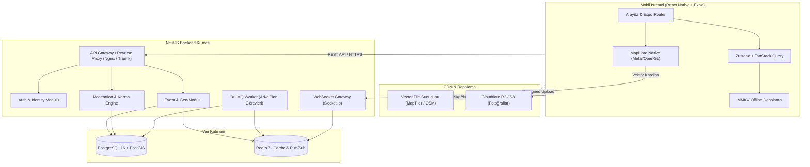
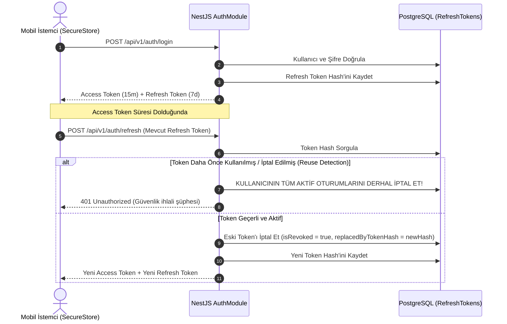

# ŞehirNabız — Teknik Mimari Belgesi (ARCHITECTURE.md)

Bu belge, ŞehirNabız mobil uygulaması ve sunucu altyapısının uçtan uca teknik mimarisini, teknoloji seçimlerinin gerekçelerini ve sistem tasarım prensiplerini detaylandırır.

---

## 1. Mimari Genel Bakış

ŞehirNabız; yüksek frekansta coğrafi olay bildirimleri alan, bu bildirimleri doğruluk filtresinden geçiren ve on binlerce eşzamanlı mobil kullanıcıya akıcı harita deneyimi sunan dağıtık bir sistemdir.



---

## 2. Mobil Harita Kütüphanesi Seçimi ve Analizi

Mobil harita katmanı, uygulamanın çekirdek bileşenidir. Expo ekosistemindeki başlıca çözümler karşılaştırmalı olarak incelenmiştir:

| Kriter | `react-native-maps` | `@maplibre/maplibre-react-native` | `react-native-webview` + Leaflet |
| :--- | :--- | :--- | :--- |
| **Render Motoru** | Apple Maps (iOS) / Google Maps (Android) | MapLibre Native (GPU / OpenGL / Metal) | WebView (DOM / Canvas) |
| **Expo Go Uyumluluğu** | Kısmi (Temel haritalar çalışır) | **Çalışmaz** (Dev Client gerektirir) | Çalışır |
| **Expo Dev Client (Prebuild)** | Desteklenir (Config Plugin) | **Tam Destek** (Official Config Plugin) | Desteklenir |
| **New Architecture (Fabric)** | Kısmi / Geçiş aşamasında | **Tam Uyumlu** (v11+ Native C++ Core) | Uyumlu |
| **Büyük Ölçekli Marker Performansı**| 150-300+ markerdan sonra FPS düşüşü | **10.000+ marker GPU clustering (60 FPS)**| Düşük performans / Donma |
| **Özel Vektör Tile ve Stiller** | Çok sınırlı (Sadece Google JSON stili) | **Sınırsız** (Mapbox GL Style Spec uyumlu) | Yüksek |
| **Maliyet ve Sağlayıcı Kilidi** | Google Cloud faturalandırması zorunlu | **Sağlayıcı Bağımsız** (OSM, MapTiler, Self-host)| Sağlayıcı Bağımsız |
| **Offline Vektör Önbellek** | Desteklenmez (Google önbelleğine bağımlı) | **Tam Destek** (Offline Pack Manager) | Sınırlı |

### Seçim Kararı ve Gerekçe: `@maplibre/maplibre-react-native`

1. **Performans:** Şehir ölçeğinde aynı anda yüzlerce olayın (trafik, kaza, yol çalışması, etkinlik) haritada pinlenmesi gerekir. MapLibre, verileri GPU seviyesinde GeoJSON kaynağı ve `SymbolLayer` / `CircleLayer` olarak doğrudan ekrana çizer; React Native JS köprüsünü (bridge) meşgul etmez.
2. **Maliyet ve Bağımsızlık:** Google Maps API, kullanıcı sayısı arttıkça yüksek harita yükleme ve geocoding faturalarına yol açar. MapLibre ile açık kaynak MapTiler, Stadia veya kendi sunucumuzda barındırılan OpenStreetMap vektör karo sunucuları (Martin / pg_tileserv) kullanılabilir.
3. **Expo Prebuild & SDK 58 Uyumu:** Projemiz profesyonel bir üretim (production) mimarisi hedeflediğinden Expo Go kısıtlamalarına bağımlı değildir; Expo SDK 58 (`expo-dev-client`) ile React Native 0.88 New Architecture üzerinde derleme yapılandırılmıştır.

---

## 3. Backend Mimarisi (`apps/api`: NestJS 12 + PostgreSQL/PostGIS)

### 3.1 Neden NestJS?
- **Katmanlı ve Modüler Yapı:** Controller, Service, Repository, DTO ve Entity ayrımı ile kurumsal kod kalitesi (`apps/api` modülü).
- **Dependency Injection (DI):** Test edilebilirlik (Vitest / E2E) ve modüller arası gevşek bağlılık (loose coupling).
- **TypeScript Strict Entegrasyonu:** Derleme zamanı tip güvenliği ve Zod tabanlı ortak DTO doğrulaması.
- **WebSocket & Microservice Desteği:** İlerleyen fazlarda bildirim veya analitik servislerinin ayrılmasına hazır yapı.

### 3.2 ORM Karar Analizi: TypeORM vs Prisma vs Drizzle
PostgreSQL + PostGIS uzamsal yetenekleri ve NestJS 12 ekosistemi için üç temel ORM değerlendirilmiştir:

| Kriter | TypeORM (Seçilen) | Prisma | Drizzle ORM |
| :--- | :--- | :--- | :--- |
| **PostGIS Spatial Tipleri** | **Tam Destek (`@Column('geometry')`)** | Kısıtlı (`Unsupported` veri tipi) | Eklenti/Custom Type gerekir |
| **Spatial Fonksiyonlar & GIST** | **Dahili (`@Index({ spatial: true })`)** | Sadece `$queryRaw` ile mümkün | SQL template ile mümkün |
| **NestJS Entegrasyonu** | **Resmi `@nestjs/typeorm` (Birinci sınıf)** | Topluluk paketi / Servis wrapper | Manuel Provider yapılandırması |
| **Migration Yönetimi** | **Dahili çift yönlü (Up/Down) CLI** | Şema odaklı deklaratif migration | Drizzle-kit migration |
| **TypeScript Strict Uyum** | Tam uyumlu (`strictPropertyInitialization` ! ile)| Tam uyumlu | Tam uyumlu |

**Karar Gerekçesi:** ŞehirNabız'ın çekirdeği coğrafi uzamsal sorgulardır (`ST_DWithin`, `ST_MakeEnvelope`, `GIST`). Prisma'nın PostGIS tiplerini birinci sınıf desteklemeyip raw SQL'e zorlaması dezavantajdır. TypeORM, NestJS'in yerleşik modüler yapısına, transaction yönetim mekanizmasına ve PostGIS spatial entity desteğine en uygun çözümdür.

### 3.3 Oturum ve Token Yaşam Döngüsü (Token Rotation & Reuse Detection)


### 3.2 PostgreSQL + PostGIS Uzamsal (Spatial) Stratejisi
Tüm coğrafi veriler WGS 84 (`SRID 4326`) projeksiyon sisteminde tutulur.

- **Veri Tipi:** `geometry(Point, 4326)` (Hassas mesafe hesaplamaları için gerektiğinde `geography(Point, 4326)` fonksiyonları veya `ST_Transform` kullanılır).
- **Uzamsal İndeksleme:** Coğrafi sorguların milisaniye altında yanıt vermesi için tüm konum sütunlarında `GIST (Generalized Search Tree)` indeksi kullanılır:
  ```sql
  CREATE INDEX idx_events_location_gist ON events USING GIST(location);
  ```
- **Kritik Uzamsal Sorgular:**
  1. **Yarıçap Sorgusu (`ST_DWithin`):** Kullanıcının bulunduğu noktadan $R$ km uzaklıktaki olayları listeleme.
     ```sql
     SELECT id, title, category, ST_AsGeoJSON(location) 
     FROM events 
     WHERE ST_DWithin(location, ST_SetSRID(ST_MakePoint(:lon, :lat), 4326)::geography, :radiusInMeters)
       AND status = 'ACTIVE';
     ```
  2. **Görünür Ekran Kapsama Sorgusu (`ST_MakeEnvelope`):** Haritanın bounding box (bbox) sınırları içindeki olayları çekme:
     ```sql
     SELECT id, title, location 
     FROM events 
     WHERE location && ST_MakeEnvelope(:minLon, :minLat, :maxLon, :maxLat, 4326);
     ```
  3. **Mükerrer Bildirim Tespiti:** Yeni bildirilen bir olayın 150 metre yakınında son 30 dakikada benzer kategoride açılmış olay var mı kontrolü.

---

## 4. Durum Yönetimi ve Veri Akışı

1. **Sunucu Durumu (Server State):** `@tanstack/react-query`
   - Olay listeleri, kullanıcı profilleri ve harita pinleri için otomatik arka plan tazeleme, stale-while-revalidate ve offline önbellek desteği.
2. **İstemci Durumu (Client State):** `zustand`
   - Aktif harita filtreleri (kategori, zaman aralığı, güvenilirlik eşiği), oturum belirteçleri (tokens) ve tema ayarları.
3. **Yerel Kalıcı Depolama:** `react-native-mmkv`
   - AsyncStorage'a göre 30 kat daha hızlı, C++ tabanlı güvenli yerel anahtar-değer deposu.

---

## 5. Gerçek Zamanlı İletişim Stratejisi

- **İstemci -> Sunucu:** Olay bildirimi, fotoğraf yükleme ve teyit oylamaları HTTPS REST API üzerinden gerçekleşir.
- **Sunucu -> İstemci:**
  - **Kritik Acil Durumlar (Afet, Yol Kapanması):** Expo Push Notifications (APNs / FCM) üzerinden hedef coğrafi bölgedeki kullanıcılara anlık bildirim.
  - **Canlı Harita Güncellemeleri:** Harita ekranı açıkken WebSocket (Socket.io) kanalı üzerinden kullanıcının aktif koordinat bounding box'ına giren yeni olaylar anında haritaya eklenir.

---

## 6. Güvenilirlik ve Süreklilik Garantisi

- **Docker Compose:** Yerel geliştirme ortamında tek komutla PostgreSQL (PostGIS), Redis ve NestJS ayağa kaldırılır.
- **Graceful Degradation (Kademeli Bozulma):** Harita karo sunucusuna erişilemediğinde offline raster önbellek devreye girer. Backend bağlantısı koptuğunda MMKV'deki son başarılı sorgu verileri kullanıcıya hissettirilmeden sunulur.
