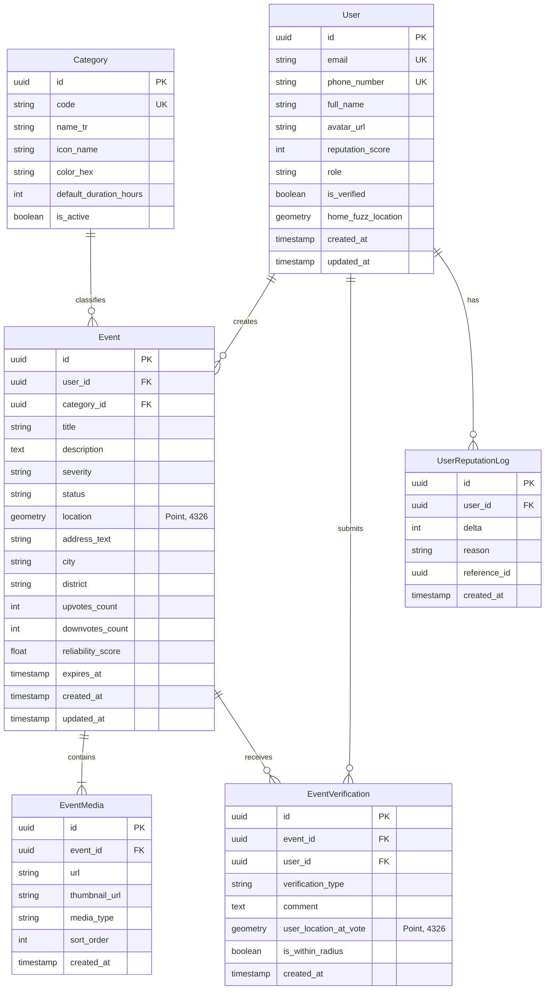

# ŞehirNabız — Veri Modelleri ve Şema Belgesi (DATA_MODELS.md)

Bu belge, ŞehirNabız sistemindeki PostgreSQL + PostGIS ilişkisel veri modelini, indeksleme stratejilerini, enum yapılarını ve veri transfer nesnelerini (DTO) tanımlar.

---

## 1. Veritabanı Varlık-İlişki Diyagramı (ERD)



---

## 2. PostgreSQL + PostGIS Tablo Şemaları (SQL)

```sql
-- PostGIS Eklentisinin Etkinleştirilmesi
CREATE EXTENSION IF NOT EXISTS "uuid-ossp";
CREATE EXTENSION IF NOT EXISTS "postgis";

-- 1. Enum Türleri
CREATE TYPE event_severity AS ENUM ('LOW', 'MEDIUM', 'HIGH', 'CRITICAL');
CREATE TYPE event_status AS ENUM ('PENDING_VERIFICATION', 'ACTIVE', 'RESOLVED', 'REJECTED_SPAM', 'EXPIRED');
CREATE TYPE verification_type AS ENUM ('CONFIRM', 'DENY', 'RESOLVED');
CREATE TYPE user_role AS ENUM ('CITIZEN', 'TRUSTED_REPORTER', 'MUNICIPAL_OFFICER', 'MODERATOR', 'ADMIN');

-- 2. Kategoriler Tablosu
CREATE TABLE categories (
    id UUID PRIMARY KEY DEFAULT uuid_generate_v4(),
    code VARCHAR(50) UNIQUE NOT NULL, -- 'TRAFFIC_ACCIDENT', 'ROAD_WORK', 'FIRE', 'INFRASTRUCTURE', 'EVENT'
    name_tr VARCHAR(100) NOT NULL,
    icon_name VARCHAR(50) NOT NULL,
    color_hex VARCHAR(7) NOT NULL,
    default_duration_hours INT NOT NULL DEFAULT 4,
    is_active BOOLEAN NOT NULL DEFAULT true,
    created_at TIMESTAMPTZ NOT NULL DEFAULT NOW()
);

-- 3. Kullanıcılar Tablosu
CREATE TABLE users (
    id UUID PRIMARY KEY DEFAULT uuid_generate_v4(),
    email VARCHAR(255) UNIQUE,
    phone_number VARCHAR(30) UNIQUE,
    password_hash VARCHAR(255),
    full_name VARCHAR(100) NOT NULL,
    avatar_url VARCHAR(500),
    role user_role NOT NULL DEFAULT 'CITIZEN',
    reputation_score INT NOT NULL DEFAULT 10,
    is_verified BOOLEAN NOT NULL DEFAULT false,
    home_fuzz_location GEOMETRY(Point, 4326),
    created_at TIMESTAMPTZ NOT NULL DEFAULT NOW(),
    updated_at TIMESTAMPTZ NOT NULL DEFAULT NOW()
);

-- 4. Olaylar (Events) Tablosu
CREATE TABLE events (
    id UUID PRIMARY KEY DEFAULT uuid_generate_v4(),
    user_id UUID NOT NULL REFERENCES users(id) ON DELETE CASCADE,
    category_id UUID NOT NULL REFERENCES categories(id),
    title VARCHAR(150) NOT NULL,
    description TEXT NOT NULL,
    severity event_severity NOT NULL DEFAULT 'MEDIUM',
    status event_status NOT NULL DEFAULT 'PENDING_VERIFICATION',
    location GEOMETRY(Point, 4326) NOT NULL,
    address_text VARCHAR(255),
    city VARCHAR(60) NOT NULL,
    district VARCHAR(60) NOT NULL,
    upvotes_count INT NOT NULL DEFAULT 0,
    downvotes_count INT NOT NULL DEFAULT 0,
    reliability_score DOUBLE PRECISION NOT NULL DEFAULT 1.0,
    expires_at TIMESTAMPTZ NOT NULL,
    created_at TIMESTAMPTZ NOT NULL DEFAULT NOW(),
    updated_at TIMESTAMPTZ NOT NULL DEFAULT NOW()
);

-- 5. Olay Medyası (Event Media) Tablosu
CREATE TABLE event_media (
    id UUID PRIMARY KEY DEFAULT uuid_generate_v4(),
    event_id UUID NOT NULL REFERENCES events(id) ON DELETE CASCADE,
    url VARCHAR(500) NOT NULL,
    thumbnail_url VARCHAR(500),
    media_type VARCHAR(20) NOT NULL DEFAULT 'IMAGE', -- 'IMAGE', 'VIDEO'
    sort_order INT NOT NULL DEFAULT 0,
    created_at TIMESTAMPTZ NOT NULL DEFAULT NOW()
);

-- 6. Olay Doğrulama / Oylama (Event Verification) Tablosu
CREATE TABLE event_verifications (
    id UUID PRIMARY KEY DEFAULT uuid_generate_v4(),
    event_id UUID NOT NULL REFERENCES events(id) ON DELETE CASCADE,
    user_id UUID NOT NULL REFERENCES users(id) ON DELETE CASCADE,
    verification_type verification_type NOT NULL,
    comment TEXT,
    user_location_at_vote GEOMETRY(Point, 4326),
    is_within_radius BOOLEAN NOT NULL DEFAULT false,
    created_at TIMESTAMPTZ NOT NULL DEFAULT NOW(),
    CONSTRAINT uq_event_user_vote UNIQUE (event_id, user_id)
);

-- 7. Kullanıcı İtibar Logları (Reputation Logs)
CREATE TABLE user_reputation_logs (
    id UUID PRIMARY KEY DEFAULT uuid_generate_v4(),
    user_id UUID NOT NULL REFERENCES users(id) ON DELETE CASCADE,
    delta INT NOT NULL,
    reason VARCHAR(150) NOT NULL,
    reference_id UUID,
    created_at TIMESTAMPTZ NOT NULL DEFAULT NOW()
);
```

---

## 3. İndeksleme Stratejileri

```sql
-- Uzamsal (Spatial) İndeksler (Milisaniyelik coğrafi mesafe sorguları için şarttır)
CREATE INDEX idx_events_location_gist ON events USING GIST (location);
CREATE INDEX idx_verifications_location_gist ON event_verifications USING GIST (user_location_at_vote);

-- B-Tree Bileşik İndeksler
CREATE INDEX idx_events_status_created ON events (status, created_at DESC);
CREATE INDEX idx_events_city_district ON events (city, district);
CREATE INDEX idx_events_expires_at ON events (expires_at) WHERE status = 'ACTIVE';
```

---

## 4. Ortak Tipler ve DTO'lar (`packages/shared`)

### 4.1 Zod Validasyon Şeması (Olay Oluşturma Örneği)
```typescript
import { z } from 'zod';

export const EventSeveritySchema = z.enum(['LOW', 'MEDIUM', 'HIGH', 'CRITICAL']);
export const EventStatusSchema = z.enum([
  'PENDING_VERIFICATION',
  'ACTIVE',
  'RESOLVED',
  'REJECTED_SPAM',
  'EXPIRED'
]);

export const CreateEventDtoSchema = z.object({
  title: z.string().min(5, 'Başlık en az 5 karakter olmalıdır').max(150),
  description: z.string().min(10, 'Açıklama en az 10 karakter olmalıdır').max(2000),
  categoryId: z.string().uuid('Geçersiz kategori kimliği'),
  severity: EventSeveritySchema.default('MEDIUM'),
  latitude: z.number().min(-90).max(90),
  longitude: z.number().min(-180).max(180),
  addressText: z.string().optional(),
  mediaKeys: z.array(z.string()).max(3, 'En fazla 3 fotoğraf eklenebilir').optional(),
});

export type CreateEventDto = z.infer<typeof CreateEventDtoSchema>;

export const VerifyEventDtoSchema = z.object({
  verificationType: z.enum(['CONFIRM', 'DENY', 'RESOLVED']),
  comment: z.string().max(500).optional(),
  latitude: z.number().min(-90).max(90).optional(),
  longitude: z.number().min(-180).max(180).optional(),
});

export type VerifyEventDto = z.infer<typeof VerifyEventDtoSchema>;
```
