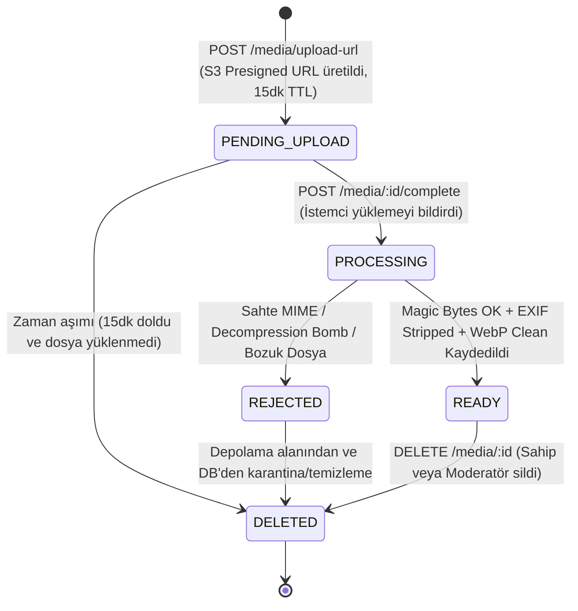

# ŞehirNabız — Medya Güvenliği ve Depolama Mimarisi (MEDIA_SECURITY.md)

Bu doküman, ŞehirNabız ekosisteminde kullanıcıların olay bildirimlerine fotoğraf eklemesi sırasında uygulanan nesne depolama (Object Storage) mimarisini, presigned URL yaşam döngüsünü, güvenlik kontrollerini ve EXIF/GPS meta veri temizleme standartlarını tanımlar.

---

## 1. Mimari Genel Bakış ve Temel İlkeler

Mobil kullanıcıların yüksek çözünürlüklü fotoğraflar yüklemesi backend sunucuları üzerinde ciddi bellek (RAM) ve I/O yükü oluşturabilir. ŞehirNabız bu darboğazı önlemek için **Doğrudan Depolamaya Yükleme (Direct-to-Storage via Presigned URL)** modelini benimser:

1. **Sıfır Sunucu Yükü (Zero-Buffer Upload):** Büyük boyutlu ham medya dosyaları doğrudan istemciden Nesne Depolama Havuzuna (MinIO / Cloudflare R2) akar; NestJS API sunucusunun bellek havuzunu tüketmez.
2. **Korumalı İşleme ve Sanitizasyon:** Yükleme tamamlandıktan sonra NestJS arka planda dosyayı çeker, sihirli bayt (magic bytes) doğrulamasından geçirir, dekompresyon bombası (decompression bomb) korumalı Sharp motoru ile EXIF/GPS meta verilerini temizler ve optimize WebP formatına dönüştürür.
3. **Katı Gizlilik (Privacy First):** Olay fotoğraflarının içine gömülü olabilecek GPS koordinatları, kamera seri numaraları, lens bilgileri ve çekim zamanı gibi kişisel veriler (KVKK/GDPR uyumu için) tamamen yok edilir.
4. **Maksimum 3 Medya Sınırı:** Bir olaya en fazla 3 aktif/bekleyen fotoğraf eklenebilir. Eşzamanlı yarış koşulları (race condition) veritabanı düzeyinde `SELECT ... FOR UPDATE` pessimistic lock ile engellenir.

---

## 2. Medya Yaşam Döngüsü ve Durum Makinesi

Her medya kaydı `event_media` tablosunda aşağıdaki durum makinesine (Finite State Machine) göre yönetilir:



### Durum Açıklamaları
- **`PENDING_UPLOAD`:** İstemciye presigned upload URL verildi; depolamada dosyanın yüklenmesi bekleniyor (maksimum 15 dakika geçerli).
- **`PROCESSING`:** İstemci yüklemenin bittiğini bildirdi; sunucu S3 üzerinde nesneyi kontrol ediyor, boyut ve format denetimi yapıyor, EXIF meta verilerini temizliyor.
- **`READY`:** EXIF temizlendi, optimize WebP nesnesi oluşturuldu, SHA-256 hash alındı ve medya kullanıma açıldı.
- **`REJECTED`:** Yüklenen dosya sahte (örn. JPEG uzantılı executable veya shell script), bozuk ya da aşırı büyük çözünürlüklü tespit edildi; depolamadan derhal silinir.
- **`DELETED`:** Kullanıcı veya moderatör tarafından silinen veya reddedilen medya.

---

## 3. Güvenlik ve Doğrulama Katmanları

### 3.1 İzin Verilen MIME Türleri (MIME Whitelist)
Sadece mobil ortamda güvenli ve standart olan görüntü formatları kabul edilir:
- `image/jpeg`
- `image/png`
- `image/webp`

SVG, PDF, GIF, HEIC/HEIF doğrudan yüklemeye kapalıdır. SVG dosyaları potansiyel XSS (Stored XSS via XML script) riski taşıdığı için kesinlikle reddedilir.

### 3.2 Sihirli Bayt (Magic Bytes / File Signature) Denetimi
İstemcinin HTTP başlığında (`Content-Type`) beyan ettiği değer asla referans kabul edilmez. Sunucu, S3'e yüklenen dosyanın ilk 16 baytını doğrudan okuyarak ikili imzasını denetler:

| Dosya Türü | Sihirli Bayt (Hex İmza) |
| :--- | :--- |
| **JPEG** | `FF D8 FF` |
| **PNG** | `89 50 4E 47 0D 0A 1A 0A` |
| **WebP** | `52 49 46 46` ... `57 45 42 50` (RIFF + WEBP) |

Bu imzalardan birine uymayan her dosya `REJECTED` durumuna geçirilir ve depolamadan karantina silme işlemiyle kaldırılır.

### 3.3 Dekompresyon Bombası (Zip Bomb / Pixel Flood) Koruması
Saldırganlar birkaç kilobaytlık sıkıştırılmış bir JPEG dosyasını sunucuya gönderip açıldığında gigabaytlarca RAM tüketmesine neden olabilir (Image Decompression Bomb).
- Sharp kütüphanesine `limitInputPixels: 268402689` (yaklaşık 16384x16384 piksel) katı üst sınırı uygulanmıştır.
- Maksimum kabul edilen dosya boyutu: **8 MB (8,388,608 bayt)**.

### 3.4 EXIF, GPS ve Meta Veri Temizleme (Sanitization)
Tüm onaylanan fotoğraflar `sharp` işlemcisinden geçirilir:
1. `sharp(buffer, { failOn: 'error' })` ile yüklenir.
2. `.rotate()`: Mobil cihazın yön sensörüne göre fotoğraf otomatik düzeltilir.
3. `.resize(1920, 1080, { fit: 'inside', withoutEnlargement: true })`: Yüksek çözünürlüklü fotoğraflar maksimum Full HD çözünürlüğe ölçeklenir.
4. `.webp({ quality: 80 })`: **EXIF, XMP, IPTC veya ICC profili aktarılmaz.** Sonuç dosyasında EXIF bilgisi `undefined` haline gelir.
5. Dosya `events/{eventId}/clean/{mediaId}.webp` anahtarıyla güvenli depolama bölgesine kaydedilir.
6. Ham geçici dosya S3 üzerinden silinir.

### 3.5 Bütünlük Sağlama (SHA-256 Checksum)
Temizlenen her görselin SHA-256 kriptografik özeti çıkarılır ve `event_media.checksum` sütununa yazılır. Bu özet dosyanın CDN üzerinde manipüle edilmediğini veya sonradan değiştirilmediğini garanti eder.

---

## 4. Olay ve Medya Erişim Kontrolü (Authorization & Privacy)

### 4.1 Maksimum 3 Fotoğraf Kuralı (Pessimistic Lock)
```typescript
await queryRunner.manager.query(
  `SELECT id FROM events WHERE id = $1 FOR UPDATE`,
  [eventId]
);
```
- Eşzamanlı isteklerde iki paralel oturumun aynı anda 3'ten fazla fotoğraf yüklemesini engellemek için olay satırı kilitlenir.
- Aktif ve beklemedeki (`status != DELETED AND status != REJECTED`) fotoğraf sayısı >= 3 ise `BadRequestException` fırlatılır.

### 4.2 Görünürlük Kuralları
- **`ACTIVE` ve `RESOLVED` Olaylar:** Medyaları herkese açıktır (`OptionalJwtAuthGuard`).
- **`PENDING_REVIEW` veya `REJECTED` Olaylar:** Sadece olayı oluşturan kullanıcı (`owner`) veya `MODERATOR` / `ADMIN` rolündeki kullanıcılar görebilir. Anonim veya yetkisiz istekler `404 Not Found` alır (Olayın varlığı dahi ifşa edilmez).

---

## 5. Nesne Depolama Entegrasyonu: MinIO (Dev) -> Cloudflare R2 (Prod)

Uygulama katmanı depolama sürücüsüne değil, soyut `IStorageService` arayüzüne bağımlıdır. Her iki ortam da standart AWS S3 v3 protokolünü (`@aws-sdk/client-s3`) konuşur.

| Özellik | Yerel Geliştirme (Local/Test) | Üretim Ortamı (Production) |
| :--- | :--- | :--- |
| **Depolama Sağlayıcı** | MinIO (Docker Container) | Cloudflare R2 (Global Dağıtık) |
| **Endpoint** | `http://127.0.0.1:9000` | `https://<account-id>.r2.cloudflarestorage.com` |
| **Egress (Çıkış) Ücreti** | Ücretsiz (Yerel ağ) | **0$ Egress Maliyeti** (Cloudflare avantajı) |
| **CDN Entegrasyonu** | Yerel Presigned Download URL | Cloudflare CDN (Edge Cache & Custom Domain) |
| **TLS/SSL** | Düz HTTP (`forcePathStyle: true`) | Otomatik SSL/TLS |
| **Otomatik Kova (Bucket) Açılışı** | `onModuleInit` ile otomatik kontrol & oluşturma | Terraform / Cloudflare Dashboard |

### Üretime Geçiş Konfigürasyonu
Üretime geçerken kodda hiçbir değişiklik yapılmaz; yalnızca ortam değişkenleri güncellenir:
```env
STORAGE_ENDPOINT=https://<cloudflare_account_id>.r2.cloudflarestorage.com
STORAGE_REGION=auto
STORAGE_ACCESS_KEY_ID=<cloudflare_r2_access_key>
STORAGE_SECRET_ACCESS_KEY=<cloudflare_r2_secret_key>
STORAGE_BUCKET_NAME=sehir-nabiz-media
STORAGE_PUBLIC_URL=https://media.sehirnabiz.app
STORAGE_FORCE_PATH_STYLE=false
```
