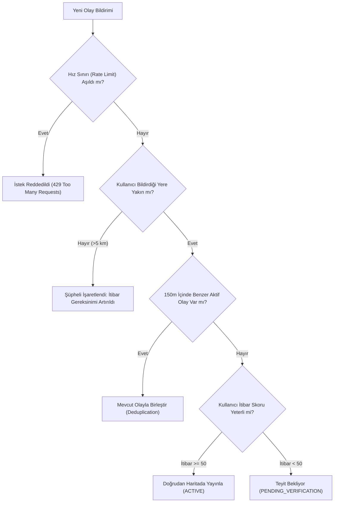

# ŞehirNabız — Güvenlik, Gizlilik, Moderasyon ve Maliyet Analizi (SECURITY_PRIVACY.md)

Bu belge, ŞehirNabız platformunda kullanıcı gizliliğinin korunması, sahte bildirimlerin elenmesi, moderasyon algoritmaları, veri güvenliği standartları ve altyapı maliyet projeksiyonlarını kapsar.

---

## 1. Konum Gizliliği ve KVKK / GDPR Uyumu

Kullanıcıların harita tabanlı uygulamalardaki en büyük endişesi, gerçek zamanlı konumlarının veya ev/iş adresi gibi mahrem noktalarının ifşa olmasıdır.

### 1.1 Konum Bulanıklaştırma (Fuzzy Location & Noise Injection)
- **Kullanıcı Profili Konumu:** Kullanıcının bildirim almak istediği ev/mahalle merkezi veritabanında kesin koordinat olarak değil, 250 ila 500 metre rastgele yarıçapta bir ofset ile bulanıklaştırılarak (`home_fuzz_location`) saklanır.
- **Anonim Bildirim Sahibi:** Bir olayı bildiren kullanıcının kesin anlık konumu arayüzde asla gösterilmez. Yalnızca olayın gerçekleştiği nokta gösterilir.
- **Doğrulama Konumu:** Kullanıcı bir olayı teyit ederken (`CONFIRM`), cihazının o an olay yerine 500m mesafe içinde olup olmadığı sunucuda (`is_within_radius`) hesaplanır; kullanıcının kesin enlem/boylamı veritabanından kalıcı olarak silinir veya loglanmaz.

### 1.2 Medya Sanitizasyonu (EXIF / Metadata Stripping)
- Akıllı telefon kameraları fotoğraflara çekildiği cihaz modeli, kesin GPS enlem/boylamı ve çekim saatini (EXIF verisi) gömer.
- **İstemci Tarafında Temizleme:** Mobil istemcide `expo-image-manipulator` kullanılarak görsel yeniden encode edilir (JPEG compression) ve tüm EXIF/GPS meta verileri istemciden çıkmadan önce silinir.
- **Sunucu Tarafında Doğrulama:** Yüklenen görseller S3/R2 bucket'ına girmeden önce Sharp/ImageMagick filtresinden geçirilerek temizlenir.

---

## 2. Sahte Bildirim ve Spam Önleme Mekanizmaları

Kötü niyetli kullanıcıların asılsız panik yaratması veya haritayı kirletmesini engellemek için çok katmanlı savunma hattı kurulmuştur:



### 2.1 İtibar (Reputation / Karma) Algoritması
- Her yeni kullanıcı sisteme **10 Güvenilirlik Puanı** ile başlar.
- Olay onaylandığında (+5 puan), yanlış/yalan bildirim teyit edildiğinde (-20 puan ve 24 saat bildirim yasağı).
- Güvenilirlik puanı 0'ın altına düşen kullanıcıların bildirimleri otomatik olarak "REJECTED_SPAM" statüsüne alınır ve moderatör onayı olmadan haritada gösterilmez.

### 2.2 Coğrafi Mükerrer Bildirim Engelleme (Spatial Deduplication)
Bir kaza veya yol çalışması olduğunda onlarca kişi aynı olayı bildirebilir.
- Yeni bir olay geldiğinde PostGIS üzerinde şu sorgu çalıştırılır:
  ```sql
  SELECT id FROM events 
  WHERE category_id = :categoryId 
    AND status IN ('ACTIVE', 'PENDING_VERIFICATION')
    AND ST_DWithin(location, ST_SetSRID(ST_MakePoint(:lon, :lat), 4326)::geography, 150)
    AND created_at > NOW() - INTERVAL '45 minutes';
  ```
- Eşleşme bulunursa yeni bir olay kartı açılmaz; kullanıcının girdisi mevcut olaya "teyit/katkı" (`EventVerification` veya ek fotoğraf) olarak iliştirilir.

---

## 3. Topluluk Moderasyonu ve Güvenilirlik Skoru

Bir olayın haritada ne kadar süre ve hangi güvenilirlikte duracağını topluluk belirler:

$$\text{Güvenilirlik Skoru} = \frac{\sum (\text{Teyit Edenlerin İtibarı} \times \text{Yakınlık Ağırlığı})}{\sum (\text{Yalanlayanların İtibarı} \times \text{Yakınlık Ağırlığı}) + 1}$$

- **Olay Yerindekilerin Ağırlığı:** Olay yerine 300 metre mesafeden teyit veren kullanıcının oyu, uzaktan oy verene kıyasla 3 kat daha ağırlıklıdır.
- **Kendi Kendine Çözülme (Auto-Expiry):** Kategoriye göre (örneğin yol çalışması 6 saat, küçük kaza 1.5 saat) süre dolduğunda otomatik olarak "EXPIRED" statüsüne geçer.

---

## 4. Kullanım Maliyetleri ve Optimizasyon Projeksiyonu

Platformun sürdürülebilirliği için yüksek maliyetli üçüncü taraf bağımlılıklarından kaçınılmıştır:

| Hizmet Kalemi | Geleneksel Pahalı Yaklaşım | ŞehirNabız Optimize Çözümü | Tasarruf / Avantaj |
| :--- | :--- | :--- | :--- |
| **Harita Karoları (Tiles)** | Google Maps SDK ($7 / 1.000 yükleme) | **MapLibre + MapTiler / OpenStreetMap** (Ücretsiz / $20/ay 500k istek) | **%90+ Maliyet Tasarrufu** |
| **Görsel Depolama & CDN**| AWS S3 + CloudFront (Yüksek Egress ücreti) | **Cloudflare R2** ($0 Egress / Çıkış Trafiği Ücretsiz) | Bant genişliği maliyeti sıfırlanır |
| **Push Bildirimleri** | Üçüncü parti SMS / Ücretli bildirim servisleri | **Expo Push Service / Firebase Cloud Messaging (FCM)** | Tamamen ücretsiz ve sınırsız |
| **Veritabanı & Spatial** | Özel harita SaaS çözümleri | **PostgreSQL + PostGIS** (Hetzner / DigitalOcean Managed veya VPS) | Düşük sabit maliyet, tam kontrol |
| **Backend Barındırma** | Büyük Kubernetes kümesi | **Docker Compose / Coolify / Hetzner Cloud VPS** | Başlangıçta <$40/ay ile 50k aktif kullanıcı |


---

## 5. Mobil Kimlik Doğrulama ve Cihaz Güvenliği (Mobile Auth Strategy)

Phase 2'de geliştirilen kimlik doğrulama mimarisi mobil istemci güvenlik standartlarına tam uyumlu olarak tasarlanmıştır:

### 5.1 Token Saklama Stratejisi
1. **Access Token (15 Dakika):**
   - Yalnızca mobil uygulamanın bellek içi durumunda (Zustand state) tutulur.
   - Uygulama kapatıldığında bellekten silinir; asla diske açık metin yazılmaz.
2. **Refresh Token (7 Gün):**
   - **Kesin Kural:** `AsyncStorage` kullanılmaz (AsyncStorage şifresiz düz metin saklar, cihaz yedeklemesine sızabilir).
   - **`expo-secure-store` Kullanımı:** Refresh token iOS tarafında **Apple Keychain**, Android tarafında **Android Keystore (AES-256-GCM)** ile donanım seviyesinde şifrelenmiş alanda saklanır.
3. **Sessiz Yenileme (Silent Refresh Flow):**
   - Mobil istemci uygulama açıldığında veya 401 Unauthorized yanıtı aldığında SecureStore'daki refresh token ile `POST /api/v1/auth/refresh` çağrısı yapar.
   - Yeni gelen token çifti belleğe ve SecureStore'a güncellenir.
4. **Token Çalınma Koruması (Reuse Detection):**
   - Bir saldırgan eski bir refresh token'ı ele geçirip kullanmaya çalışırsa sunucu durumu algılar ve kullanıcının meşru cihazı dahil tüm oturumlarını anında iptal eder. Kullanıcıdan yeniden şifre ile giriş yapması istenir.
