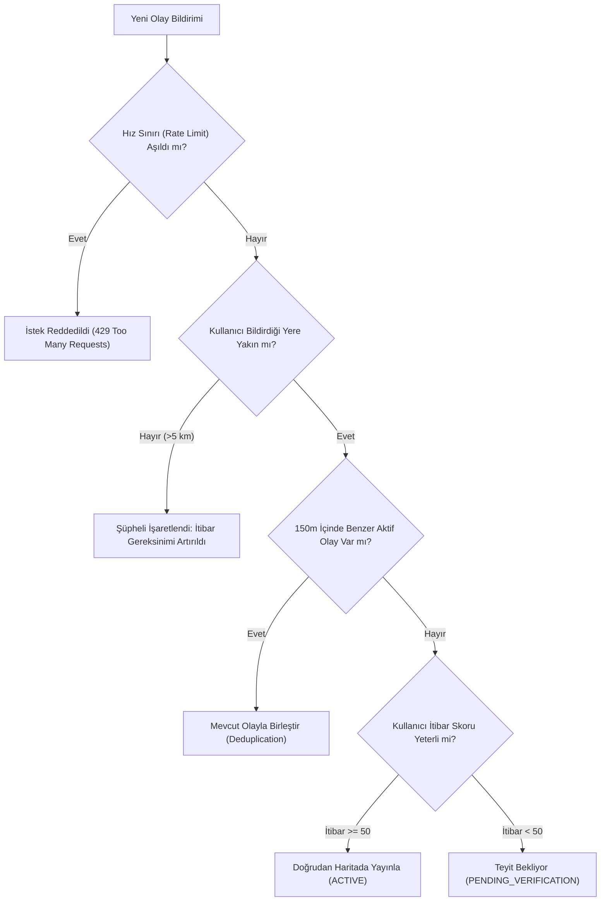

# ŞehirNabız — Güvenlik, Gizlilik, Moderasyon ve Maliyet Analizi (SECURITY_PRIVACY.md)

Bu belge, ŞehirNabız platformunda kullanıcı gizliliğinin korunması, sahte bildirimlerin elenmesi, moderasyon algoritmaları, veri güvenliği standartları ve altyapı maliyet projeksiyonlarını kapsar.

---

## 1. Konum Gizliliği, Güvenli Yayın Politikası ve KVKK / GDPR Uyumu

Kullanıcıların harita tabanlı kentsel bilgi sistemlerindeki en büyük endişesi, gerçek zamanlı konumlarının veya ev/iş adresi gibi mahrem noktalarının ifşa olmasıdır.

### 1.1 Güvenli Yayın Konumu Politikası (Safe Published Location Policy)
ŞehirNabız'da iki farklı coğrafi gereksinim dengelenir:
1. **Kamu Yararı ve Müdahale Doğruluğu:** Kaza, yol çalışması, ana su borusu patlağı gibi kentsel olaylarda koordinatın doğruluğu (metre seviyesinde) müdahale ekipleri ve sürücü yönlendirmesi için kritiktir.
2. **Kullanıcı Mahremiyeti ve Hassas Özel Mülk Güvenliği:** Bildirim yapan kullanıcının nerede bulunduğu asla ifşa edilmez.

- **Çift Çözünürlüklü Konum Modeli (Dual-Resolution Model):**
  - *İç Mekânsal Çözünürlük (Doğrulama ve PostGIS Katmanı):* Olayın gerçek koordinatı (WGS84 SRID 4326), mükerrer bildirim denetimi (`ST_DWithin` 150m), kümeleme ve belediye/saha moderasyonu için tam doğrulukla saklanır.
  - *Hassas Özel Mülk Değerlendirmesi:* Özel mülk alanlarını ilgilendiren münferit altyapı şikâyetlerinde harita yayın koordinatı 3 ondalık basamağa (~110 metre) yuvarlanarak veya rastgele 100-200m yarıçaplı dairesel tampon (`ST_Buffer`) ile genel bölge olarak haritalandırılır.
- **Kullanıcı Cihaz Konumu İzolasyonu:** Bildiren kullanıcının anlık cihaz GPS konumu sunucu veritabanına asla kaydedilmez; sunucuya yalnızca seçilen olayın koordinatı (`longitude`, `latitude`) iletilir. Kullanıcı profili için ev/iş konumu saklanmaz.
- **Doğrulama Konumu:** Kullanıcı bir olayı teyit ederken (`CONFIRM`), cihazının o an olay yerine 500m mesafe içinde olup olmadığı sunucuda (`is_within_radius`) geçici olarak hesaplanır; kullanıcının kesin enlem/boylamı kalıcı olarak silinir ve loglanmaz.

### 1.2 Mükerrer Olay Uyarısı Gizlilik Kalkanı (Duplicate Warning Privacy Shield)
Olay oluşturulurken 150m yarıçapta 45 dakika içinde benzer olay sezildiğinde:
- **Aktif/Kamuya Açık Olaylar (`status = ACTIVE`):** Olay zaten haritada herkese açık olduğundan adayın başlığı, kimliği ve mesafesi kullanıcıya bildirilir.
- **İnceleme Bekleyen veya Reddedilen Olaylar (`status = PENDING_REVIEW / REJECTED / DISPUTED`):**
  - Başka bir kullanıcının onaylanmamış taslak bildirimine ait başlık (`candidateTitle`), koordinat, yazar bilgisi, açıklama veya olay kimliği (`candidateId`) **kesinlikle sızdırılmaz**.
  - İstemciye yalnızca kişisel veri içermeyen genel uyarı metni iletilir: `"Yakın bölgede benzer bir bildirim bulunuyor olabilir."`
  - Bildirimde bulunan kullanıcının süreci kesintiye uğramadan devam etme (`onProceed`) veya iptal etme (`onCancel`) imkânı korunur.

### 1.3 Medya Sanitizasyonu (EXIF / Metadata Stripping)
- Akıllı telefon kameraları fotoğraflara çekildiği cihaz modeli, kesin GPS enlem/boylamı ve çekim saatini (EXIF verisi) gömer.
- **İstemci Tarafında Temizleme:** Mobil istemcide `expo-image-manipulator` kullanılarak görsel yeniden encode edilir (JPEG compression) ve tüm EXIF/GPS meta verileri istemciden çıkmadan önce silinir.
- **Sunucu Tarafında Doğrulama:** Yüklenen görseller S3/R2 bucket'ına girdikten sonra Sharp pipeline'ı (`limitInputPixels: 268402689`, `failOn: 'error'`, Full HD WebP dönüşümü) ile taranır ve tüm EXIF/GPS/XMP meta verileri sıfırlanır (`sanitizedMeta.exif === undefined`).

---

## 2. Sahte Bildirim ve Spam Önleme Mekanizmaları

Kötü niyetli kullanıcıların asılsız panik yaratması veya haritayı kirletmesini engellemek için çok katmanlı savunma hattı kurulmuştur:



### 2.1 İtibar (Reputation / Karma) Algoritması
- Her yeni kullanıcı sisteme **10 Güvenilirlik Puanı** ile başlar.
- Olay onaylandığında (+5 puan), yanlış/yalan bildirim teyit edildiğinde (-20 puan ve 24 saat bildirim yasağı).
- Güvenilirlik puanı 0'ın altına düşen kullanıcıların bildirimleri otomatik olarak "REJECTED_SPAM" statüsüne alınır ve moderatör onayı olmadan haritada gösterilmez.

### 2.2 Coğrafi Mükerrer Bildirim Engelleme (Spatial Deduplication)
Bir kaza veya yol çalışması olduğunda onlarca kişi aynı olayı bildirebilir.
- Yeni bir olay geldiğinde PostGIS üzerinde şu sorgu çalıştırılır:
  ```sql
  SELECT id FROM events 
  WHERE category_id = :categoryId 
    AND status IN ('ACTIVE', 'PENDING_VERIFICATION')
    AND ST_DWithin(location, ST_SetSRID(ST_MakePoint(:lon, :lat), 4326)::geography, 150)
    AND created_at > NOW() - INTERVAL '45 minutes';
  ```
- Eşleşme bulunursa yeni bir olay kartı açılmaz; kullanıcının girdisi mevcut olaya "teyit/katkı" (`EventVerification` veya ek fotoğraf) olarak iliştirilir.

---

## 3. Topluluk Moderasyonu ve Güvenilirlik Skoru

Bir olayın haritada ne kadar süre ve hangi güvenilirlikte duracağını topluluk belirler:

$$\text{Güvenilirlik Skoru} = \frac{\sum (\text{Teyit Edenlerin İtibarı} \times \text{Yakınlık Ağırlığı})}{\sum (\text{Yalanlayanların İtibarı} \times \text{Yakınlık Ağırlığı}) + 1}$$

- **Olay Yerindekilerin Ağırlığı:** Olay yerine 300 metre mesafeden teyit veren kullanıcının oyu, uzaktan oy verene kıyasla 3 kat daha ağırlıklıdır.
- **Kendi Kendine Çözülme (Auto-Expiry):** Kategoriye göre (örneğin yol çalışması 6 saat, küçük kaza 1.5 saat) süre dolduğunda otomatik olarak "EXPIRED" statüsüne geçer.

---

## 4. Kullanım Maliyetleri ve Optimizasyon Projeksiyonu

Platformun sürdürülebilirliği için yüksek maliyetli üçüncü taraf bağımlılıklarından kaçınılmıştır:

| Hizmet Kalemi | Geleneksel Pahalı Yaklaşım | ŞehirNabız Optimize Çözümü | Tasarruf / Avantaj |
| :--- | :--- | :--- | :--- |
| **Harita Karoları (Tiles)** | Google Maps SDK ($7 / 1.000 yükleme) | **MapLibre + MapTiler / OpenStreetMap** (Ücretsiz / $20/ay 500k istek) | **%90+ Maliyet Tasarrufu** |
| **Görsel Depolama & CDN**| AWS S3 + CloudFront (Yüksek Egress ücreti) | **Cloudflare R2** ($0 Egress / Çıkış Trafiği Ücretsiz) | Bant genişliği maliyeti sıfırlanır |
| **Push Bildirimleri** | Üçüncü parti SMS / Ücretli bildirim servisleri | **Expo Push Service / Firebase Cloud Messaging (FCM)** | Tamamen ücretsiz ve sınırsız |
| **Veritabanı & Spatial** | Özel harita SaaS çözümleri | **PostgreSQL + PostGIS** (Hetzner / DigitalOcean Managed veya VPS) | Düşük sabit maliyet, tam kontrol |
| **Backend Barındırma** | Büyük Kubernetes kümesi | **Docker Compose / Coolify / Hetzner Cloud VPS** | Başlangıçta <$40/ay ile 50k aktif kullanıcı |


---

## 5. Mobil Kimlik Doğrulama ve Cihaz Güvenliği (Mobile Auth Strategy)

Phase 2'de geliştirilen kimlik doğrulama mimarisi mobil istemci güvenlik standartlarına tam uyumlu olarak tasarlanmıştır:

### 5.1 Token Saklama Stratejisi
1. **Access Token (15 Dakika):**
   - Yalnızca mobil uygulamanın bellek içi durumunda (Zustand state) tutulur.
   - Uygulama kapatıldığında bellekten silinir; asla diske açık metin yazılmaz.
2. **Refresh Token (7 Gün):**
   - **Kesin Kural:** `AsyncStorage` kullanılmaz (AsyncStorage şifresiz düz metin saklar, cihaz yedeklemesine sızabilir).
   - **`expo-secure-store` Kullanımı:** Refresh token iOS tarafında **Apple Keychain**, Android tarafında **Android Keystore (AES-256-GCM)** ile donanım seviyesinde şifrelenmiş alanda saklanır.
3. **Sessiz Yenileme (Silent Refresh Flow):**
   - Mobil istemci uygulama açıldığında veya 401 Unauthorized yanıtı aldığında SecureStore'daki refresh token ile `POST /api/v1/auth/refresh` çağrısı yapar.
   - Yeni gelen token çifti belleğe ve SecureStore'a güncellenir.
4. **Token Çalınma Koruması (Reuse Detection):**
   - Bir saldırgan eski bir refresh token'ı ele geçirip kullanmaya çalışırsa sunucu durumu algılar ve kullanıcının meşru cihazı dahil tüm oturumlarını anında iptal eder. Kullanıcıdan yeniden şifre ile giriş yapması istenir.

---

## 6. Medya Güvenliği ve EXIF/GPS Sanitizasyonu (Phase 4 Uygulaması)

Kullanıcıların olaylara yüklediği görsellerin güvenliği ve kişisel verilerin korunması aşağıdaki ilkelerle garanti altına alınmıştır:

### 6.1 Presigned URL ile Doğrudan Yükleme (Direct-to-Storage)
- Mobil istemciler fotoğrafı doğrudan S3 nesne deposuna (MinIO / Cloudflare R2) yükler. Sunucu RAM darboğazı yaşamaz.
- Presigned URL süresi 15 dakika (900 saniye) ile sınırlıdır ve sadece yetkilendirilmiş istek sahibi tarafından kullanılabilir.

### 6.2 Dosya Tipi ve İçerik Doğrulama
- **İzin Verilen Türler:** Sadece `image/jpeg`, `image/png`, `image/webp`. SVG veya çalıştırılabilir dosyalar engellenir.
- **Sihirli Bayt (Magic Bytes) İncelemesi:** İstemcinin uzantı veya `Content-Type` beyanı dikkate alınmaz; dosyanın ikili başlığı (binary header) doğrulanır. Uyuşmazlık durumunda dosya anında karantinaya alınıp silinir.
- **Dekompresyon Bombası Koruması:** `sharp` motorunda piksel sınırı `limitInputPixels: 268402689` ve maksimum dosya boyutu 8 MB olarak sınırlandırılmıştır.

### 6.3 EXIF / GPS Konum Bilgisi Temizleme (Sanitization)
- Mobil kameralar fotoğraflara enlem/boylam, cihaz seri no, lens ve zaman damgası gömer.
- Sunucu arka planda görseli WebP formatına dönüştürürken tüm EXIF/XMP/IPTC meta verilerini tamamen sıfırlar (`sanitizedMeta.exif === undefined`).
- Temizlenmiş dosya yeni bir hash ve storage key ile kaydedilir; ham dosya depolamadan yok edilir.

### 6.4 Erişim Denetimi ve Olay Gizliliği
- İncelenmekte olan (`PENDING_REVIEW`) veya reddedilen (`REJECTED`) olayların fotoğrafları genel kullanıcılar tarafından görüntülenemez (`404 Not Found`). Sadece olay sahibi veya moderatörler erişebilir.
- Olay başına en fazla 3 aktif/bekleyen fotoğraf kuralı pessimistic locking (`SELECT ... FOR UPDATE`) ile garanti edilir.

---

## 7. Topluluk Teyit Güvenliği ve Moderasyon İlkeleri (Phase 8 Uygulaması)

Topluluk odaklı kentsel platformların en kırılgan tarafı bot orduları, organize manipülasyonlar ve sahte panik ihbarlarıdır:

### 7.1 Organize Oy ve Bot Koruması
1. **Tek Aktif Oy ve Çift Oy Engeli:** Veritabanında `UNIQUE("eventId", "userId")` kısıtı uygulanmıştır. Kullanıcı dilediğinde oyunu değiştirebilir veya geri çekebilir; ancak mükerrer oy veremez.
2. **Kendi Olayını Teyit Etme Yasağı:** Olayı bildiren yazar kendi olayına teyit veya itiraz veremez (`event.authorId === userId -> 400 Bad Request`).
3. **Aktif Hesap Zorunluluğu:** Yalnızca `AccountStatus.ACTIVE` durumundaki doğrulanmış hesaplar geri bildirim gönderebilir; askıya alınmış veya pasif hesaplar engellenir.
4. **Sınırsız İtibar Puanı Kasmayı Önleme:** İlk sürümde sırf oy vererek sonsuz itibar kazanılmasına izin verilmez; itibar ekonomisi manipülasyondan izole tutulur.

### 7.2 Konum Mahremiyeti ve GPS İzolasyonu
- Olay teyidi vermek için kullanıcıdan zorunlu GPS konumu talep edilmez.
- Teyit veren vatandaşların anlık kesin koordinatları sunucuda saklanmaz veya veritabanına kaydedilmez.
- GPS spoofing riskine karşı sahte konum ağırlıklandırması uygulanmaz.

### 7.3 Gizlilik Kalkanı ve Bilgi Sızıntısını Önleme
- Onaylanmamış (`PENDING_REVIEW`) veya reddedilmiş (`REJECTED`) olaylara ilişkin geri bildirim sorgulamalarında veya detay çağrılarında yetkisiz kişilere `404 Not Found` dönülür. Olayın başlığı, yazarı ve varlığı gizlenir.

### 7.4 Açıklanabilir Güvenilirlik ve Sahte Kesinlik Engeli
- Topluluk geri bildirimleri resmî belediye onayı değildir.
- Kullanıcıya *"Bu olay %95 doğrudur"* benzeri yapay zeka veya yüzde yanılsaması oluşturacak ifadeler sunulmaz.
- Sayısal döküm ("12 kişi gördü, 3 kişi itiraz etti") şeffafça ve yalnızca yeterli örneklem ($N \ge 3$) toplandığında açıklayıcı metinle gösterilir.
- Olay durumu yalnızca oy sayısına bağlı olarak otomatik `ACTIVE` veya `VERIFIED` yapılamaz. Karar süreci moderatörlerin yetkisindedir.

---

## 8. Gerçek Zamanlı İletişim ve Push Bildirim Güvenliği (Phase 9 Uygulaması)

Gerçek zamanlı harita ve anlık bildirim kanalları, kullanıcı mahremiyetini ve veri bütünlüğünü tehdit etmeyecek şekilde sıkı güvenlik protokolleriyle yapılandırılmıştır:

### 8.1 WebSocket & WSS Güvenliği ve Yetkilendirme
1. **İki Katmanlı Bağlantı Modeli:**
   - **Genel Akış (Anonim İstemciler):** Anonim kullanıcılar yalnızca kamusal olay güncellemelerini (`events:global`, coğrafi `bbox`) dinleyebilir.
   - **Kişisel ve Yönetim Akışları (Kimlik Doğrulamalı):** Kullanıcıya özel odalar (`user:${userId}`) ve moderasyon odası (`moderation:queue`) için handshake esnasında `auth.token` veya `headers.authorization` ile JWT zorunludur.
2. **Moderasyon Odası İzolasyonu:**
   - Socket istemcisi kendini moderatör olarak beyan edemez.
   - `join_moderation` isteği geldiğinde soketin doğrulanmış JWT payload'ındaki roller (`MODERATOR` veya `ADMIN`) sunucu tarafında denetlenir. Yetkisiz istemciler anında `UNAUTHORIZED_ROOM` hatası ile reddedilir.
3. **Log Sanitizasyonu:**
   - JWT, refresh token veya hassas kimlik bilgileri sunucu loglarına, konsola veya Redis Pub/Sub mesaj yüklerine asla yazdırılmaz. Hata mesajlarında yalnızca genel kimliksizleştirilmiş tanımlayıcılar yer alır.

### 8.2 Cihaz Push Token Mahremiyeti ve Güvenli Yönetim
1. **Veri Minimizasyonu:**
   - Kullanıcının gerçek donanım kimliği (IMEI, MAC adresi, benzersiz donanım serisi) kesinlikle toplanmaz.
   - `deviceIdentifier` alanı yalnızca platform adı (`expo-android`, `expo-ios`) veya güvenli yerel UUID ile sınırlandırılır.
2. **Token Güvenliği ve Tekillik:**
   - Push tokenları veritabanında `UNIQUE(token)` kısıtı ile korunur.
   - Kullanıcı başka bir hesapla giriş yaptığında veya token yenilendiğinde eski sahiplik otomatik olarak yeni hesaba geçirilir.
   - Kullanıcı çıkış yaptığında (`DELETE /devices/push-token`) cihaz tokenı anında `isActive = false` yapılarak oturumlar arası bildirim sızıntısı engellenir.
3. **Ölü Token Temizliği (Stale Token Eviction):**
   - Push servisinden `DeviceNotRegistered` yanıtı alındığında ilgili token veritabanında pasife alınır ve bir sonraki push döngüsünde filtrelenir.

### 8.3 Bildirim Tercihleri ve Konum İzni Kalkanı
1. **Varsayılan Kapalı Konum Bildirimi:**
   - `nearbyEvents` (Yakınımdaki gelişmeler) tercihi yeni kullanıcılarda **varsayılan olarak KAPALIDIR (`false`)**.
   - Kullanıcı açık rıza verip konumuyla ilgili bildirim almak istemediği sürece konum bazlı bildirim iletilmez.
2. **Yetki Temelli Bildirim Tetikleyicileri:**
   - Bildirimler yalnızca kullanıcının doğrudan ilişkili olduğu eylemler için üretilir: `REPORTED_EVENT_VERIFIED`, `FEEDBACK_DISPUTED`, `EVENT_RESOLVED`, `MODERATION_ACTION`.
   - İnceleme aşamasındaki (`PENDING_REVIEW`) veya reddedilen (`REJECTED`) olaylar kamusal WebSocket odalarına (`events:global`) asla yayınlanmaz. Yalnızca yetkili moderasyon odasına ve olay sahibinin özel kanalına iletilir.

---

## 9. Şehir İstatistikleri, Arama ve Kullanıcı Portali Gizliliği (Phase 10 Uygulaması)

### 9.1 Şehir İstatistikleri & Isı Haritası Mahremiyeti
1. **Afet ve Risk Yanılsamasının Önlenmesi:**
   - Şehirdeki bildirim yoğunluğu, doğrudan o bölgenin tehlikeli veya riskli olduğu anlamına gelmez (daha çok bildirim yapan aktif vatandaş varlığı olabilir).
   - Bu nedenle istatistik ve ısı haritası arayüzlerinde zorunlu olarak şu açıklama yer alır:
     > *"İstatistikler ve yoğunluk haritası ŞehirNabız üzerinde yayınlanan kullanıcı bildirimlerine dayanmaktadır; tüm gerçek olayların eksiksiz kaydını temsil etmez."*
2. **Uzamsal Izgara ile Mahremiyet Koruma:**
   - Isı haritasında tekil kullanıcı koordinatları doğrudan haritaya basılmaz; PostGIS seviyesinde 3 ondalık basamak (~110m) ızgara kutularına toplanarak ham konumlar kümülatif ağırlığa dönüştürülür.
   - Böylece harita üzerindeki ısı lekelerinden belirli bir kişinin ev veya iş yerinin tam koordinatı deşifre edilemez.

### 9.2 Kamusal Arama Gizlilik Kalkanı
1. **Kamusal Olmayan Olayların İzolasyonu:**
   - Kamusal arama (`GET /api/v1/events/search`) sorgularında veritabanı düzeyinde filtreleme uygulanır (`status IN ('ACTIVE', 'RESOLVED', 'DISPUTED')`).
   - İncelenmekte olan (`PENDING_REVIEW`) veya moderatörlerce reddedilen (`REJECTED`) olaylar kamusal arama sonuçlarına kesinlikle dahil edilmez.
2. **Karakter ve Hız Sınırı:**
   - Veritabanı kaynak tüketimini ve crawling saldırılarını önlemek için arama sorguları en az 2 karakter olmalıdır.
   - Arama uç noktası rate limiting zırhı ile korunur.

### 9.3 Kullanıcı Portali ve "Bildirimlerim" İzolasyonu
1. **Yazar Bazlı Veri Yalıtımı (`GET /api/v1/users/me/events`):**
   - Kullanıcı yalnızca kendi kimliğiyle (`userId = currentUser.id`) açtığı olayları görebilir.
   - Başka kullanıcıların incelenmekte olan veya reddedilmiş olaylarına bu uç noktadan veya arama üzerinden erişilemez.
2. **Güvenli Moderasyon Red Gerekçesi Gösterimi:**
   - Reddedilen olaylar için moderatörün girdiği gerekçe (`rejectionReason`) yalnızca olay sahibine gösterilir.
   - Hassas moderatör iç notları arındırılır; kullanıcıya rehberlik eden yapıcı red gerekçesi sunulur.

### 9.4 Ayarlar ve Tercih Yönetimi
1. **Varsayılan Kapalı Konum Bildirimi:**
   - `nearbyEvents` ayarı sunucuda ve istemcide varsayılan olarak kapalıdır; rıza olmadan konum takibi yapılmaz.
2. **Oturum Kapatma & Veri Temizliği:**
   - Kullanıcı ayarlar veya profil ekranından çıkış yaptığında SecureStore'daki tokenlar temizlenir, sunucudaki push token pasife alınır ve yerel önbellek sıfırlanır.

---

## 10. Phase 11 Sertleştirmesi: Outbox Atomisitesi, k-Anonymity ve Koordinat İzolasyonu

### 10.1 Dört Farklı Koordinat Türü Ayrımı
1. **Bildiren Cihaz Konumu (Reporter Device Location):** Donanım GPS'i asla veritabanına yazılmaz, loglanmaz veya dışarı sızdırılmaz.
2. **Olay Konumu:** Kullanıcının seçtiği olay koordinatıdır; PostGIS geometry formatında saklanır.
3. **Kamuya Açık Koordinatlar:** Yalnızca onaylanmış olaylar kamusal haritada gösterilir.
4. **Agregasyon Koordinatları:** Isı haritasında 110m ızgara merkezine yuvarlanır.
- Detaylar [PRIVACY_DATA_FLOW.md](file:///C:/Users/Okul/OneDrive/Belgeler/ŞehirNabız/docs/PRIVACY_DATA_FLOW.md) belgesindedir.

### 10.2 Heatmap k-Anonymity / Sparse Cell Suppression
- Seyrek bölgelerdeki tekil olayların konumunun doğrudan okunmasını engellemek için, bir ızgara hücresindeki olay sayısı belirlenen eşiğin altındaysa ($k < 2$), o hücre gizlenir (`suppressedPoints`).

### 10.3 Transactional Outbox & Çift Yazma Koruması
- Veritabanı durum değişikliği ile harici bildirimler PostgreSQL Transactional Outbox deseniyle atomikleştirilmiştir (`outbox_events`).
- `FOR UPDATE SKIP LOCKED` ile worker kilit yönetimi ve `user_notifications.idempotency_key` ile tüketici idempotansı sağlanmıştır.
- Detaylar [TRANSACTIONAL_OUTBOX.md](file:///C:/Users/Okul/OneDrive/Belgeler/ŞehirNabız/docs/TRANSACTIONAL_OUTBOX.md) belgesindedir.

### 10.4 Türkçe Karakter Duyarsız Arama (unaccent)
- PostgreSQL `unaccent` extension ile büyük/küçük `ı/i`, `İ/I`, `ş/s`, `ç/c`, `ö/o`, `ü/u`, `ğ/g` harfleri için arama zırhı oluşturulmuştur.


